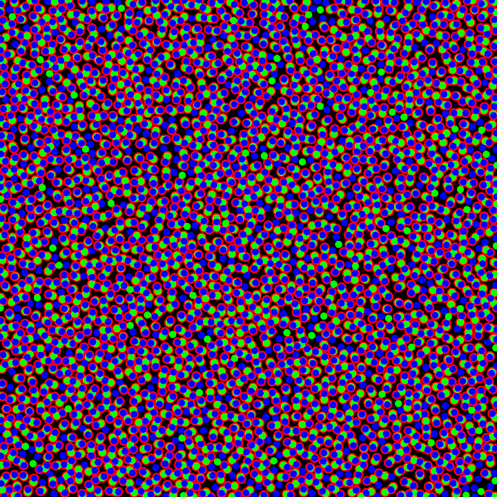
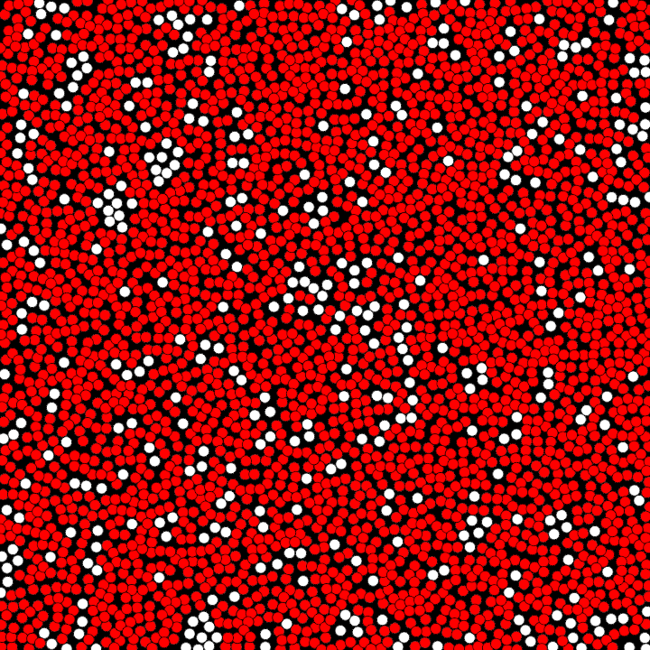
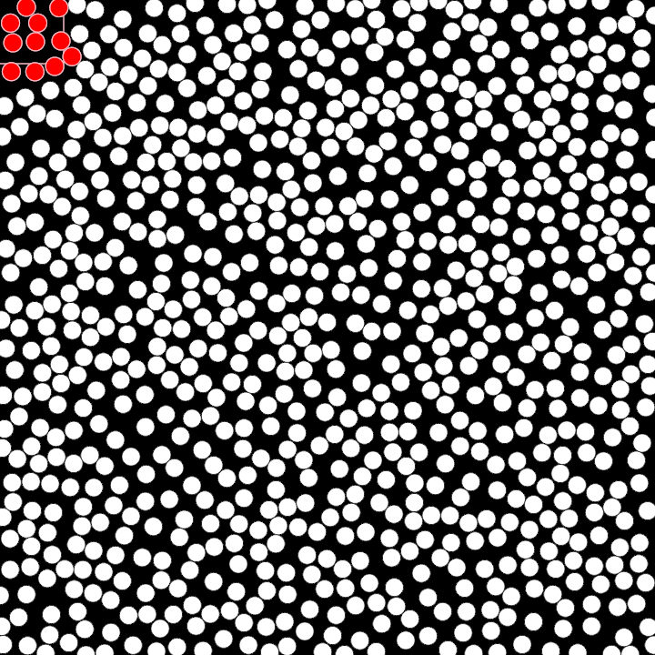

# orx-bvh

Bounding Volume Hierarchy: a tree structure used to speed up ray/geometry intersection tests. 

It wraps groups of geometric objects in progressively larger bounding volumes, so you can test the simpler boxes first and only test the detailed geometry when needed.

<!-- __demos__ -->
## Demos
### DemoBipartiteIntersections01

Demonstrates how to quickly find intersecting or overlapping circles between two collections of circles using
BVH (Bounding Volume Hierarchy) data structures.

[source code](src/jvmDemo/kotlin/DemoBipartiteIntersections01.kt)

### DemoIntersections01

Demonstrates how to quickly find overlapping circles in a collection of scattered circles using BVH.

The circles are placed with a scatter radius of 5.0, but the circle radii are actually 6.0, so some
overlap will likely happen.

The BVH data structure is created out of the rectangular bounding boxes of the circles.

The `findIntersectingPairs()` is used to find all intersections between those bounding boxes.
Next, the program creates a list of circles that actually intersect, not just their bounding boxes.

The original circles are then rendered white, and the intersecting ones in red.

[source code](src/jvmDemo/kotlin/DemoIntersections01.kt)

### DemoRectangleQuery01

Interactive demonstration of how to quickly find the scattered circles that are touching or contained by a rectangle
placed at the mouse position, using BHV.

The `bvh.queryRectangle(q)` method is used to get the indices of all the circles that are intersecting the query
rectangle.

[source code](src/jvmDemo/kotlin/DemoRectangleQuery01.kt)
