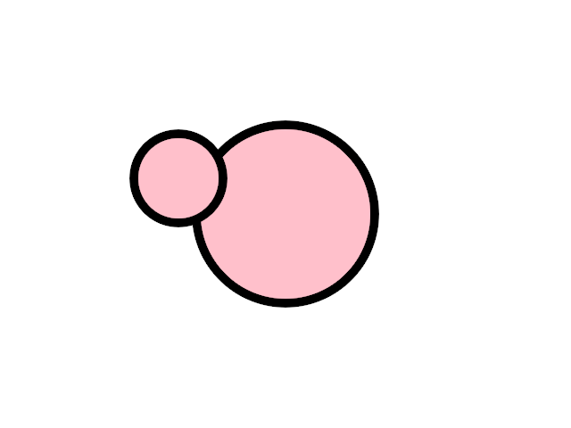
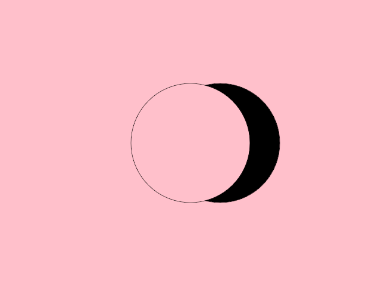
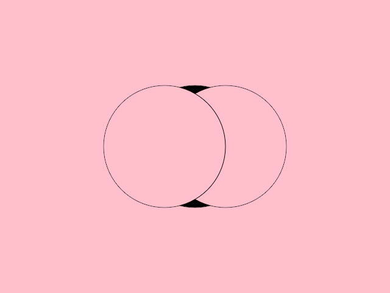
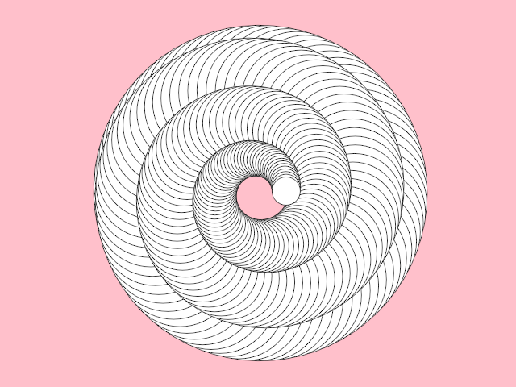
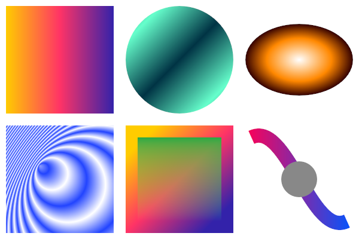
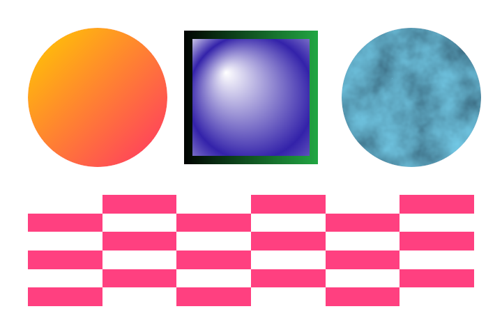
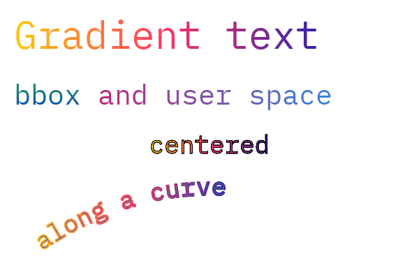

# orx-composition

Create, inspect, and modify vector-based designs.

One can think of a Composition as a vector design made out of primitives
like ShapeContour, Shape, or LineSegment, each having its fill color,
stroke color and stroke weight.

Compositions can be loaded from SVG files and then queried or altered via code.

Composition can also be generated from scratch, typically using `drawComposition { ... }`, then saved as an SVG file.

Read about Composition [in the guide](https://guide.openrndr.org/drawing/drawingSVG.html).

_The code in `orx-composition` was previously found under `openrndr-draw` in the `openrndr` repository._

<!-- __demos__ -->
## Demos
### DemoCompositionDrawer01

Demonstrates how to

- Create a Composition
- Draw it on the program window
- Save it to an SVG file
- Print the SVG content as text

[source code](src/jvmDemo/kotlin/DemoCompositionDrawer01.kt)

### DemoCompositionDrawer02

Demonstrates how to draw a Composition and how to use
`ClipMode.REVERSE_DIFFERENCE` to clip shapes.

The first shape clips part of the second one away,
producing a shape that seems to be behind the first one.

Without clipping, the second circle would cover part of the first one.

[source code](src/jvmDemo/kotlin/DemoCompositionDrawer02.kt)

### DemoCompositionDrawer03

Draws a composition using 3 circles and `ClipMode.REVERSE_DIFFERENCE`.

A println() demonstrates that the result contains 3 shapes:
a complete circle, a moon-like shape, and a shape with two small black areas.

One way to verify this is by saving the design as an SVG file and opening
it in vector editing software.

[source code](src/jvmDemo/kotlin/DemoCompositionDrawer03.kt)

### DemoCompositionDrawer04

Demonstrates how to add content to and how to clear an existing Composition.

A number of circles are added when the program starts.
Dragging the mouse button adds more circles.
Right-clicking the mouse clears the Composition.

[source code](src/jvmDemo/kotlin/DemoCompositionDrawer04.kt)

### DemoCompositionDrawer05

Demonstrates how to

- Create a Composition with a group
- Add XML attributes so the group appears as a layer in Inkscape

[source code](src/jvmDemo/kotlin/DemoCompositionDrawer05.kt)

### DemoCompositionGradients01

Demonstrates drawing an SVG document with gradients: linear and radial gradients in object bounding box and user
space units, with spread methods, a focal point, a gradient that inherits its stops from another one and is
rotated, stop opacity and a gradient stroke.

Gradients are parsed into gradient paints of the composition, which are drawn with paint shade styles.

[source code](src/jvmDemo/kotlin/DemoCompositionGradients01.kt)

### DemoCompositionPaints01

Demonstrates paints in a composition: shapes are filled and stroked with gradients, which are written to SVG, and
with presets, such as noise and checkers, which are animated by changing their properties.

The composition is written to SVG and printed: gradients become linearGradient and radialGradient elements, presets
are written as their fallback color.

[source code](src/jvmDemo/kotlin/DemoCompositionPaints01.kt)

### DemoCompositionTextGradients01

Demonstrates gradients on text: a gradient over the bounds of a text element, a tspan with a gradient in user
space, a centered text and text along a path with gradient fills and strokes.

Gradients over the bounds of text span the whole text element, like in browsers: the bounds are the union of the
cells of all its glyphs, also when the text is placed along a path.

[source code](src/jvmDemo/kotlin/DemoCompositionTextGradients01.kt)
