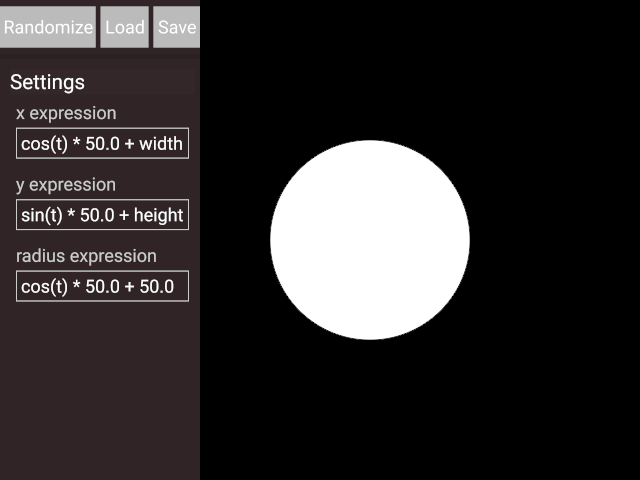
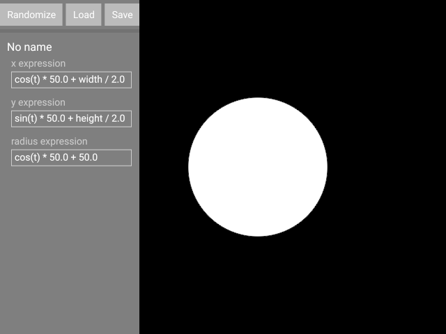
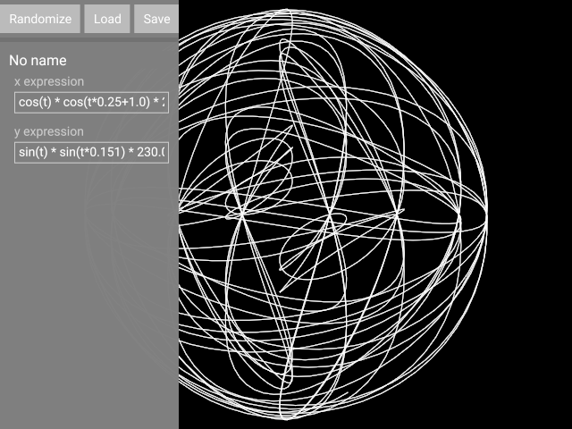

# orx-expression-evaluator

Evaluate strings containing mathematical expressions, of numbers or, in typed expressions, of numbers, strings,
vectors, colors and more.

Write a formula as text, in a GUI text field, a settings file or a live-coding session, and use it in your program
right away, without recompiling.

```kotlin
evaluateExpression("sin(t) * 100.0 + width / 2.0", mapOf("t" to 0.5, "width" to 640.0)) // 367.94…
```

## Which evaluator should I use?

There are two evaluators. They read the same kind of expressions; they differ in what those expressions can work
with.

- **The untyped evaluator**, in `org.openrndr.extra.expressions`, works with numbers only: every value is a
  `Double`, and so is every result. Use it when a formula gives a number: a position, a size, a speed, an animation
  curve. It's the simplest of the two, and it has a couple of things that help with live editing, like
  [property delegates](#property-delegates) and functions that keep running while an expression is broken.
- **The typed evaluator**, in `org.openrndr.extra.expressions.typed`, also works with vectors, colors, matrices,
  strings and lists, and has comparisons, conditions (`a > b ? x : y`) and lambdas (`points.map { it * 2 }`). Use
  it when your formulas need any of those, or when you want to hand your own objects to an expression.

Not sure? Start with the untyped evaluator. Switching later takes a few small changes, listed in
[moving to the typed evaluator](#moving-from-the-untyped-to-the-typed-evaluator).

Both packages have functions named `compileFunction1`, `compileFunction2` and `compileFunction3`, so your imports
decide which evaluator you get.

## The untyped evaluator

### Evaluating an expression

```kotlin
import org.openrndr.extra.expressions.evaluateExpression

evaluateExpression("x + y", mapOf("x" to 1.0, "y" to 2.0)) // 3.0
```

An expression can use:

- numbers, like `3`, `0.25`, `.5` and `1e-3`
- `+`, `-`, `*`, `/`, `%` and parentheses. `%` wraps around, which is handy for angles and grid cells: `-1 % 3`
  is `2.0`
- the names of constants you pass in, and `PI`
- the [built-in functions](#built-in-functions) and [your own](#your-own-functions)

An expression can also be a small program. Put statements on separate lines or separate them with semicolons:
`val` gives a value a name and `fun` declares a function, for the statements that follow. The last statement gives
the result. The body of a function is an expression, or a block in `{ }` that ends in one.

```kotlin
evaluateExpression("val a = 5; val b = 3; a + b") // 8.0
evaluateExpression("fun f(x) { x * 5.0 }; fun g(x) = x * 6.0; val a = f(5); val b = g(a); a + b") // 175.0
```

Comparisons, conditions, strings and vectors are not available here; they are in the
[typed evaluator](#the-typed-evaluator).

### Compiling an expression to a function

When you evaluate the same expression over and over, say every frame, compile it once and call the function you get:

```kotlin
import org.openrndr.extra.expressions.compileFunction1
import org.openrndr.extra.expressions.compileFunction2

val f = compileFunction1("x * 5.0 + cos(x)", "x")
f(0.0) // 1.0

val g = compileFunction2("x * 5.0 + cos(x) * y", "x", "y")
g(0.0, 0.4) // 0.4
```

`compileFunction3` works the same way, with three parameters.

`compileFunction1`, `compileFunction2` and `compileFunction3` copy the constants when they compile, so changes to
the map after that don't reach the function. For values that change between calls, use parameters, or use
`compileExpression`, which reads the map at every call:

```kotlin
val values = mutableMapOf("t" to 0.0)
val brightness = compileExpression("sin(t) * 0.5 + 0.5", values)

values["t"] = PI / 2.0
brightness() // 1.0
```

### When an expression is broken

People make typos, especially while they're still typing. What happens then depends on the function:

- `evaluateExpression` and `compileExpression` throw an `ExpressionException`, for example for a missing
  parenthesis, an unknown name or a function called with the wrong number of arguments.
- `compileFunction1`, `compileFunction2` and `compileFunction3` never throw. When the expression can't be read or
  evaluated, the function returns what its `error` function gives, `0.0` unless you pass your own. This keeps a sketch
  running while someone is halfway through a formula:

```kotlin
val f = compileFunction1("x * (2.0 +", "x", error = { x -> x })
f(3.0) // 3.0, because the expression is incomplete
```

### Property delegates

`watchingExpression1`, `watchingExpression2` and `watchingExpression3` turn a `String` property into a function.
The function is compiled again only when the text changes. Connect the property to a text field in
[orx-gui](../orx-jvm/orx-gui/) and you can edit the formulas while your program runs; the [demos](#demos) below do
exactly that.

```kotlin
val constants = mutableMapOf("width" to 300.0)
val settings = object {
    var xExpression = "cos(t) * 50.0 + width / 2.0"
}
val xFunction by watchingExpression1(settings::xExpression, "t", constants)

xFunction(1.0)
```

Like `compileFunction1`, these never throw, take an `error` function, and copy the constants when they compile.

### Built-in functions

| Function                                                                    | Notes                                                       |
|-----------------------------------------------------------------------------|-------------------------------------------------------------|
| `abs(x)`, `ceil(x)`, `floor(x)`, `round(x)`                                 | `round` rounds halves away from zero: `round(-2.5)` is `-3` |
| `sqrt(x)`, `exp(x)`, `pow(x, n)`                                            |                                                             |
| `sin(x)`, `cos(x)`, `tan(x)`, `asin(x)`, `acos(x)`, `atan(x)`, `atan2(y, x)` | angles in radians                                           |
| `degrees(x)`, `radians(x)`                                                  | convert radians to degrees and back                         |
| `min(a, b, …)`, `max(a, b, …)`                                              | 2 to 5 arguments                                            |
| `sum(a, b, c, …)`                                                           | 3 to 5 arguments                                            |
| `mod(x, y)`                                                                 | the same as `x % y`                                         |
| `saturate(x)`                                                               | `x` clamped to [0, 1]                                       |
| `mix(a, b, f)`                                                              | `a` when `f` is 0, `b` when `f` is 1, in between otherwise  |
| `smoothstep(e0, e1, x)`                                                     | goes smoothly from 0 to 1 as `x` goes from `e0` to `e1`     |
| `map(x0, x1, y0, y1, v)`                                                    | `v` mapped from the range [x0, x1] to [y0, y1]              |
| `length(x, y)`, `length(x, y, z)`, `length(x, y, z, w)`                     | the length of the vector                                    |
| `random()`, `random(a, b)`                                                  | a random number in [0, 1), or in [a, b)                     |

### Your own functions

Add functions of 0 to 5 numeric arguments with `FunctionExtensions`:

```kotlin
val functions = FunctionExtensions(
    functions1 = mapOf("wave" to { x -> sin(x * 2.0 * PI) * 0.5 + 0.5 }),
    functions2 = mapOf("snap" to { x, size -> floor(x / size) * size })
)
evaluateExpression("snap(wave(0.3) * 100.0, 10.0)", functions = functions) // 90.0
```

A built-in function wins over one of yours with the same name and number of arguments.

### Checking an expression without evaluating it

To mark mistakes in a text field as someone types, `checkExpression` gives every problem it finds, with where it is in
the text:

```kotlin
val problems = checkExpression("sin(t) * (amp", values = setOf("t", "amp"))
problems.single().message // "missing ')'"
problems.single().start   // 9, the position of the '('
```

Each `ExpressionProblem` has a `kind` (a syntax error, an unknown value or function, the wrong number of arguments, …),
a `message`, and `start` and `end` positions in the text. An `ExpressionException` carries the same list in its
`problems`. `expressionNames(expression)` gives the names of the values an expression reads.

A compiled function from the untyped evaluator is meant to be called from one thread at a time. If you evaluate on
several threads, compile one function per thread.

## The typed evaluator

### Evaluating an expression

```kotlin
import org.openrndr.extra.expressions.typed.evaluateTypedExpression

evaluateTypedExpression("vec2(1.0, 2.0) * 3") // Vector2(3.0, 6.0)
```

Constants are given by a function from a name to a value, or `null` when there is no such name. To use a map, pass
its `get`:

```kotlin
val values = mapOf("center" to Vector2(320.0, 240.0), "t" to 0.0)
evaluateTypedExpression("center + vec2(cos(t), sin(t)) * 100", values::get) // Vector2(420.0, 240.0)
```

The function is called every time the expression is evaluated, so it can give values that change, like
`{ name -> if (name == "t") seconds else null }`.

Programs work like in the untyped evaluator, and the body of a lambda can be a block of statements too, across
several lines:

```kotlin
evaluateTypedExpression("val v = vec2(1.0, 2.0); val s = 3; v * s") // Vector2(3.0, 6.0)
evaluateTypedExpression("fun scaled(xs, k) = xs.map { it * k }; scaled([1, 2], 3)") // [3.0, 6.0]
evaluateTypedExpression("""
    [1, 2].map {
        val y = it * 2
        y + 1
    }
""".trimIndent()) // [3.0, 5.0]
```

### Compiling an expression to a function

```kotlin
import org.openrndr.extra.expressions.typed.compileFunction1

val position = compileFunction1<Double, Vector2>("vec2(cos(t), sin(t)) * 100", "t")
position(0.0) // Vector2(100.0, 0.0)
```

You choose the types of the parameters and of the result. Nothing checks them when the expression is compiled: if
the expression gives something else, you get an error where the result is used. `compileFunction2` and
`compileFunction3` take two and three parameters, and `compileTypedExpression` compiles an expression without
parameters.

### Values and operators

**Numbers** are all `Double`s, even `1` and the numbers in `[1, 2, 3]`.

**Vectors** are made with `vec2(x, y)`, `vec3(x, y, z)` and `vec4(x, y, z, w)`. A single number fills every
component (`vec3(0.5)`), and a smaller vector can stand in for some of the numbers (`vec3(v, 1.0)`,
`vec4(v, 0.0, 1.0)`).
- properties: `.x`, `.y`, `.z`, `.w`, `.length`, `.normalized`, and the swizzles `.xy`, `.yx`, `.xz`, `.zx`, `.yz`,
  `.zy`, `.xx`, `.yy` and `.xyz`, of the vectors that have those components
- the same properties as in OPENRNDR for going to homogeneous coordinates and back: `.xy0`, `.xy1`, `.xy00` and
  `.xy01` of a `vec2`, `.xyz0` and `.xyz1` of a `vec3`, and `.div` of a `vec4`, which divides `x`, `y` and `z` by
  `w`. So a point is transformed by a matrix like in Kotlin: `(m * p.xyz1).div`
- `+` and `-` between vectors of the same size, `-v`, and `*`, `/` and `%` by a vector of the same size, component
  by component
- `*` and `/` by a number, with the number on the right: `v * 2` works, `2 * v` doesn't

**Colors** are made with `rgb(r, g, b)`, `rgba(r, g, b, a)`, `rgb(gray)`, `rgb(vec3(r, g, b))` and
`rgba(vec4(r, g, b, a))`, or passed in as constants, like `ColorRGBa.PINK`.
- properties: `.r`, `.g`, `.b`, `.a`, `.linear` and `.srgb`
- member functions: `.shade(f)` and `.opacify(f)`
- `+` and `-` between colors, `*` and `/` by a number (on the right)

**Matrices** are made with `translate(v)`, `rotate(axis, degrees)`, `scale(s)` and `mat4(c0, c1, c2, c3)` from four
`vec4` columns.
- `transpose(m)` and `inverse(m)`, or the properties `.transposed` and `.inversed`
- `+` and `-` between matrices, and `*` by a matrix, a `vec4` or a number:
  `(translate(vec3(1.0, 0.0, 0.0)) * vec4(0.0, 0.0, 0.0, 1.0)).xyz` is `Vector3(1.0, 0.0, 0.0)`

**Strings** are written in double quotes: `"hello"`.
- properties: `.length`, `.uppercase`, `.lowercase` and `.reversed`
- member functions: `.take(n)`, `.drop(n)`, `.takeLast(n)` and `.dropLast(n)`
- `+` joins two strings and `* n` repeats one. A number can't be added to a string

**Lists** are written in brackets, `[1, 2, 3]`, and `xs[0]` gives the first element.
- `+` joins two lists and `* n` repeats one
- member functions: `.first()`, `.last()`, `.take(n)`, `.drop(n)`, `.takeLast(n)`, `.dropLast(n)`, `.reversed()`,
  `.min()`, `.max()`, `.sorted()`, `.zip(other)`, which gives pairs as lists of two
- with a lambda: `.map { }`, `.filter { }`, `.minBy { }`, `.maxBy { }`, `.sortedBy { }` and
  `.sortedByDescending { }`

**Ranges** give lists of numbers: `0..10`, `0..<10`, `0 until 10`, `10 downTo 0` and `0..10 step 2`.

```kotlin
evaluateTypedExpression("(0 until 4).map { vec2(it * 10, 0) }") // [Vector2(0.0, 0.0), Vector2(10.0, 0.0), …]
evaluateTypedExpression("""["one", "two", "three"].maxBy { it.length }""") // "three"
```

**Lambdas** are written `{ it * 2 }`, `{ x -> x * 2 }` or `{ a, b -> a + b }`, with at most two parameters.

**Conditions**: there are no booleans. The comparisons `==`, `<`, `<=`, `>` and `>=` give `1.0` for true and
`0.0` for false, and `&&`, `||`, `!` and `condition ? a : b` take a number as true when it rounds to anything but 0.
`==` compares numbers, vectors, colors and strings; the others compare numbers only. There is no `!=`; write
`!(a == b)`.

```kotlin
evaluateTypedExpression("t > 0.5 ? rgb(1.0) : rgb(0.0)", mapOf("t" to 0.8)::get) // white
```

**Shapes and coordinates** from OPENRNDR have properties too: a `Circle` has `.center`, `.x`, `.y`, `.radius` and
`.area`; a `Rectangle` has `.x`, `.y`, `.width`, `.height`, `.center`, `.corner` and `.area`; `Polar` and
`Spherical` have `.theta`, `.radius` and `.cartesian`, and `Spherical` also `.phi`. Properties of a `Map` read its
entries: with `settings` a map, `settings.size` is `settings["size"]`.

### Built-in functions

The typed evaluator has all the [built-in functions](#built-in-functions) of the untyped one, and more. Most of them
work on numbers and, component by component, on vectors:

- `abs`, `acos`, `asin`, `atan`, `atan2(y, x)`, `ceil`, `clamp(x, min, max)`, `cos`, `degrees`, `exp`, `floor`,
  `fract`, `log`, `mod(x, y)`, `pow(x, y)`, `radians`, `round`, `saturate`, `sign`, `sin`, `smoothstep(e0, e1, x)`,
  `sqrt` and `tan`
- `min(a, b, …)` and `max(a, b, …)` of 2 to 5 arguments, `sum(a, b, c, …)` of 3 to 5, and
  `map(x0, x1, y0, y1, v)`, which maps `v` from the range [x0, x1] to [y0, y1]
- `random(a, b)`, a random number in [a, b). With vectors, every component is random on its own, so
  `random(vec2(0.0), vec2(width, height))` is a random point on the screen

Where one of these takes more than one argument, a number can stand in for a vector: `clamp(v, 0.0, 1.0)`,
`max(v, 0.0)`.

The others:

- `mix(a, b, f)`, of two numbers or two vectors of the same size
- `length(x, y)`, `length(x, y, z)` and `length(x, y, z, w)`, the length of the vector of those numbers; the length of
  a vector you already have is `v.length`
- `normalize(v)`, and `random()`, a random number in [0, 1)
- the vector, color and matrix functions above, and the constant `PI`

### Your own functions and properties

`TypedFunctionExtensions` adds functions of 0 to 5 arguments. The arguments arrive as `Any`; numbers are `Double`s.
Its `properties` function lets expressions read properties of your own objects; return `null` for a property you
don't have.

```kotlin
class Particle(val mass: Double)

val functions = TypedFunctionExtensions(
    functions1 = mapOf("twice" to { x -> (x as Double) * 2.0 }),
    properties = { receiver, name ->
        if (receiver is Particle && name == "mass") receiver.mass else null
    }
)
evaluateTypedExpression("twice(it.mass)", { if (it == "it") Particle(1.5) else null }, functions) // 3.0
```

A constant can also be a Kotlin function, which the expression then calls: with
`mapOf("wave" to { x: Double -> sin(x) })::get` as the constants, `wave(t)` works.

### When an expression is broken

The typed evaluator throws an `ExpressionException`, the same class as the untyped one:

- `compileTypedExpression` and `compileFunction1`, `compileFunction2` and `compileFunction3` throw when the
  expression can't be read
- the functions they give throw when something goes wrong while evaluating, like an unknown name or `"a" + 2`
- `compileFunction1OrNull`, `compileFunction2OrNull` and `compileFunction3OrNull` give `null` instead of throwing
  when the expression can't be read, and pass what went wrong to `onError`

`checkTypedExpression(expression, values)` and `typedExpressionNames(expression)` work like the untyped
[`checkExpression` and `expressionNames`](#checking-an-expression-without-evaluating-it). The types of values aren't
known before an expression is evaluated, so the check finds syntax errors, unknown names and wrong numbers of
arguments, but not `"a" + 2`.

A compiled function from the typed evaluator can be called from several threads at once.

### Moving from the untyped to the typed evaluator

Everything you can write for the untyped evaluator works in the typed one too, with the same built-in functions, so
your expressions don't need to change. Your code does:

- import from `org.openrndr.extra.expressions.typed`
- pass the constants as a function, like `constants::get`, instead of a map
- give the types of the parameters and the result: `compileFunction1<Double, Double>(…)`
- broken expressions throw instead of giving `0.0`, so catch the `ExpressionException`, or use
  `compileFunction1OrNull`
- there are no property delegates, so compile again when the text changes

<!-- __demos__ -->
## Demos
### DemoExpressionEvaluator01

Demonstrates the use of `evaluateExpression` to process strings containing mathematical expressions.

In this demo, expressions are evaluated on every animation frame. Notice how the `t`, `width`,
and `height` values are passed to the evaluator, allowing these variables to be used directly
within the expressions.

Evaluating expressions enables dynamic behavior adjustments at runtime, eliminating the need
to recompile the program.



[source code](src/jvmDemo/kotlin/DemoExpressionEvaluator01.kt)

### DemoExpressionEvaluator02

Improved version of DemoExpressionEvaluator01, it uses [watchingExpression1] to automatically convert an expression
string into a function with a parameter "t".

By using [watchingExpression1], the resulting function is only updated when the content of its first argument
(a String) changes, which uses less CPU than evaluating the expression on every animation frame.



[source code](src/jvmDemo/kotlin/DemoExpressionEvaluator02.kt)

### DemoExpressionEvaluator03

Spirograph-like demo of orx-expression-evaluator, using [watchingExpression1] to automatically convert an expression
String into a function with a parameter "t".

The program generates a list with 2000 points and draws a line strip connecting them.

Editing the expression may make it temporarily invalid. When this happens, it returns 0.0 (for instance,
due to non-matching parenthesis). This is normally not an issue, but the `lineStrip()` method fails
when consecutive points are identical, which is the case if all points are Vector2(0.0).
Therefore, we wrap it in a try/catch to keep the program running even while the expressions are not valid.



[source code](src/jvmDemo/kotlin/DemoExpressionEvaluator03.kt)
