# orx-gradient-descent

Finds equation inputs that output a minimum value: easy to use gradient descent based minimizer. 

## Usage

```kotlin
// define a model
class Model {
    var x = 0.0
    var y = 0.0 
}

val model = Model()
minimizeModel(model) { m ->
    (m.x-4.0)*(m.x-4.0) + (m.y-3.0)*(m.y-3.0)
}

// model.x is close to 4 and model y is close to 3 at this point
```

## Based on g9

orx-gradient-descent is based on [g9](https://omrelli.ug/g9/) ([source](https://github.com/bijection/g9), MIT
license), a JavaScript library for interactive graphics. `gradient` and `minimize` are a Kotlin port of g9's
minimizer, `minimize.js`, a quasi-Newton (BFGS) minimizer with a backtracking line search, which g9 adapted from the
`gradient` and `uncmin` functions of [numeric.js](https://github.com/sloisel/numeric) by Sébastien Loisel (MIT
license).

The demos also follow g9's idea of direct manipulation: a drawing is computed from a few parameters, and dragging any
point of the drawing changes the parameters, by minimizing the distance from that point to the mouse, such that the
point follows the mouse and the rest of the drawing follows the parameters. `DragParameters`, in the demos, does this
for any drawing and adds to it:
- `affects`, the parameters that dragging a point may change, as g9's `affects` option does;
- `damping`, which prefers the smallest change of the parameters, for drawings of more parameters than a point needs;
- `penalty`, a term of the parameters minimized with the distance, for constraints that dragging keeps;
- `grab`, which lets a drawing be dragged by any place, not only by its points.

The demos after examples of the [g9 gallery](https://omrelli.ug/g9/gallery/) are `DemoDragMirror01`,
`DemoDragRings01`, `DemoDragBezier01`, `DemoDragCircle01`, `DemoDragCube01`, `DemoDragDragon01`, `DemoDragTree01`,
`DemoDragTurtle01`, `DemoDragGridWarp01`, `DemoDragCrank01`, `DemoDragAffects01`, `DemoDragClamp01`, `DemoDragClock01`
and `DemoDragImage01`; the others take the idea further, to hyperbolic and spherical geometry, Möbius
transformations, linkages, inverse kinematics, fitting, letters, tilings, quasicrystals and magnetic fields.

## Data binding

Currently we support minimizing model classes that contain 
`Double`, `Vector2`, `Vector3` and `Vector4` typed properties, 
other types are silently ignored.

An example of a supported model:
```kotlin
class Model {
    var x = 0.0
    var y = 0.0
    var v2 = Vector2.ZERO
}
```
<!-- __demos__ -->
## Demos
### DemoDragAffects01

Three lines of the same kind, of 12 parameters, the ends of the lines, of which [DragParameters.affects] limits
what dragging changes: the ends of the white line move freely; of the pink line only the start moves, its end
stays put; the blue line's start only moves sideways and its end only up and down.

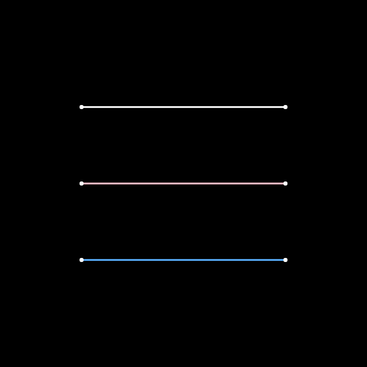

[source code](src/jvmDemo/kotlin/DemoDragAffects01.kt)

### DemoDragArm01

Inverse kinematics: an arm of six links, of which the parameters are the angles of the joints, each relative to the
link before. Dragging the tip, or any joint, turns the joints such that it follows the mouse, see [DragParameters];
damping makes the joints that have to turn least do the work, and every joint but the shoulder bends at most 135°
either way, which the arm then works around.

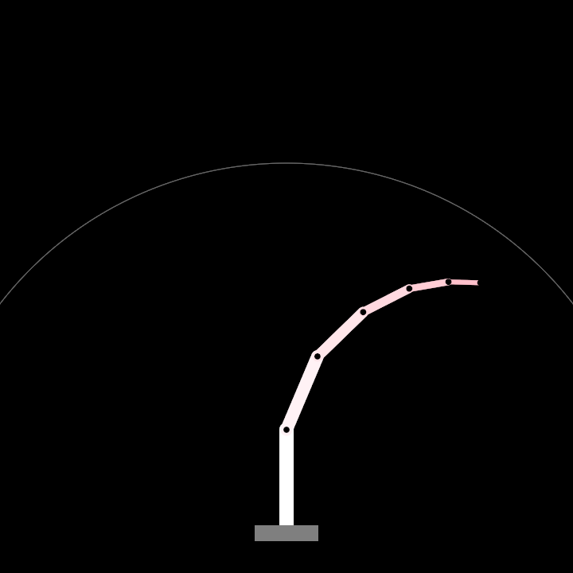

[source code](src/jvmDemo/kotlin/DemoDragArm01.kt)

### DemoDragBezier01

A quadratic Bézier curve of three control points and the point at t on it, with the construction of de Casteljau
that finds that point. All four points can be dragged, see [DragParameters]: dragging the point on the curve moves
the control points and t together, so the point can slide along the curve and pull it.

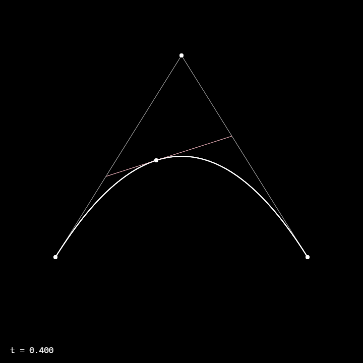

[source code](src/jvmDemo/kotlin/DemoDragBezier01.kt)

### DemoDragCircle01

The circle through three points, of which the center is the crossing of the perpendicular bisectors of two chords.
The three points and the center can be dragged, see [DragParameters]: dragging the center moves the three points,
as little as gradient descent finds, to put it where the mouse is.

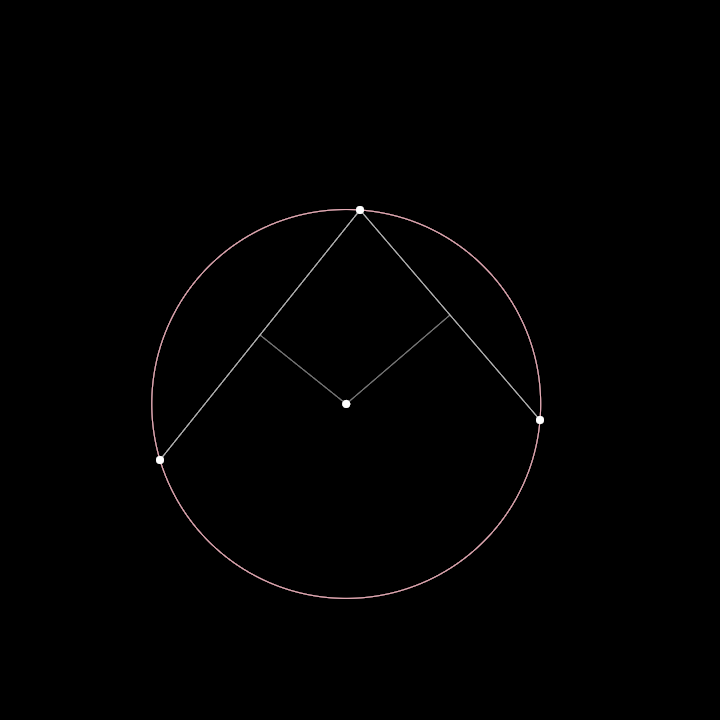

[source code](src/jvmDemo/kotlin/DemoDragCircle01.kt)

### DemoDragClamp01

A point clamped between two limits: on the line it stays between the pink limits, 20 away from them, while the
free point below it follows the mouse anywhere. Dragging the clamped point moves it within the limits; dragged past
a limit the clamp does not change with the free point any more, so gradient descent moves the limit instead, see
[DragParameters]. The limits can be dragged too.

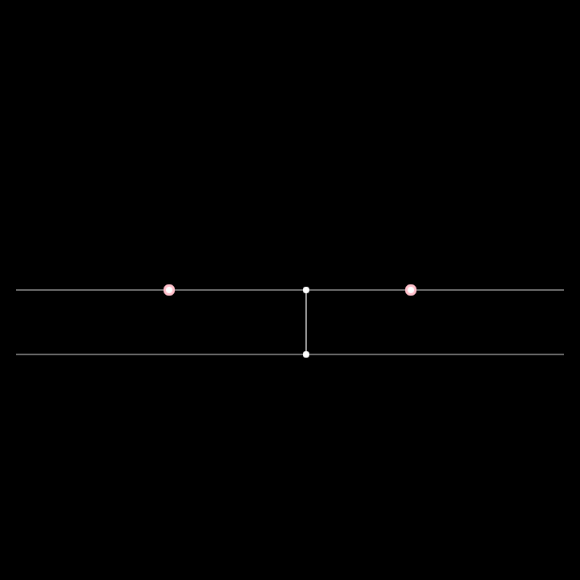

[source code](src/jvmDemo/kotlin/DemoDragClamp01.kt)

### DemoDragClock01

A clock of one parameter, the time in seconds, which runs on its own while no hand is dragged. Its three hands can
all be dragged, see [DragParameters]: they all set the time, so turning the minute hand once turns the hour hand a
twelfth and the second hand 60 times.

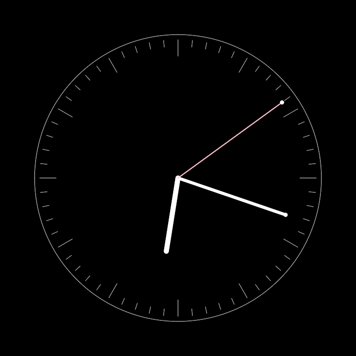

[source code](src/jvmDemo/kotlin/DemoDragClock01.kt)

### DemoDragCrank01

A crank and a piston, of one parameter, the angle of the crank: a rod joins the pin of the crank to the piston,
which moves up and down in its cylinder. Dragging the pin turns the crank; dragging the piston turns it too, to the
nearest angle that puts the piston where the mouse is, see [DragParameters]. When nothing is dragged the crank turns
on its own.

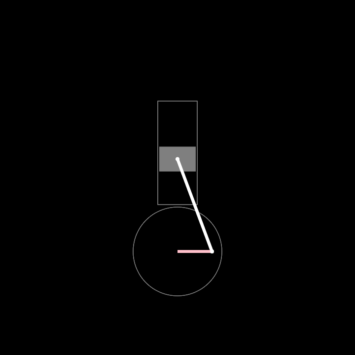

[source code](src/jvmDemo/kotlin/DemoDragCrank01.kt)

### DemoDragCube01

A cube in perspective of two angles of rotation, around the x and the y axis. Dragging a corner turns the cube,
see [DragParameters]: the angles change such that the corner goes where the mouse is, as far as turning can bring it.

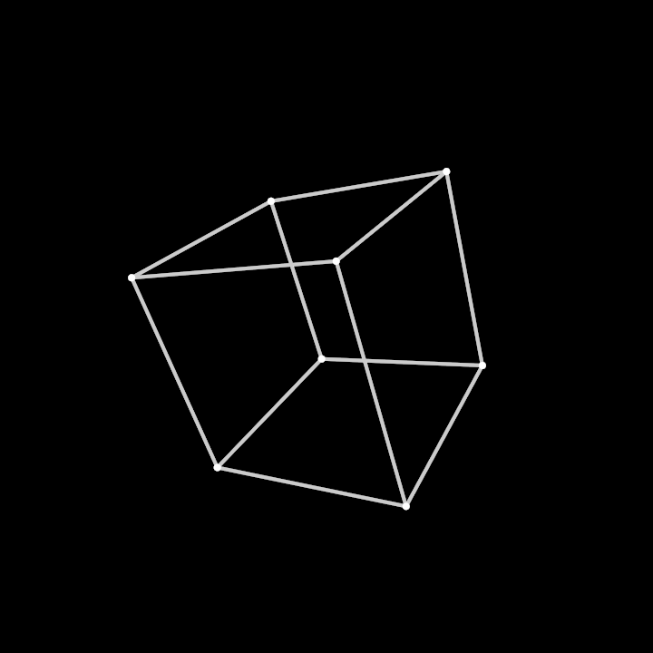

[source code](src/jvmDemo/kotlin/DemoDragCube01.kt)

### DemoDragDoyle01

A Doyle spiral: circles of which every one touches six others, centered at a^m b^n for two complex numbers a and b,
each of a radius r times the distance of its center to the center of the spiral. That the circles touch is three
equations, of the circles at 1, a and b, and that the spiral closes after p steps of a and q of b is a fourth,
a^p = b^q: these are solved for a, b and r with gradient descent, [minimize], from a hexagonal grid of circles.
The arrow keys change p and q, which solves the spiral of them.

The spiral is the same when turned and scaled by a or b, which dragging shows: any place can be grabbed, which turns
and zooms the view such that it follows the mouse, see [DragParameters.grab], in and out without end.

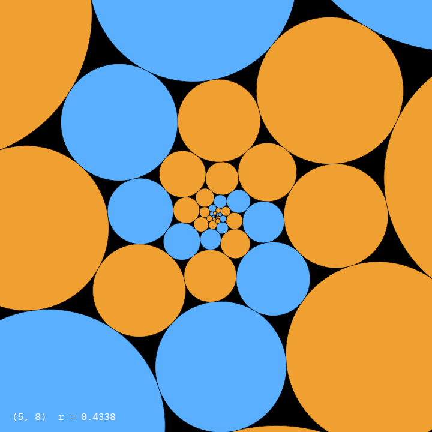

[source code](src/jvmDemo/kotlin/DemoDragDoyle01.kt)

### DemoDragDragon01

A dragon curve between two end points: every segment is folded at its middle, which moves sideways by the
squareness times half its length, to the left and the right in turn, nine times over. Dragging any corner of the
curve changes the squareness and the end points, see [DragParameters].

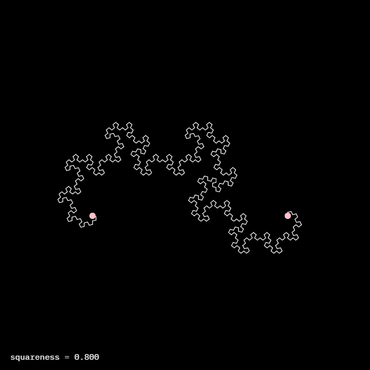

[source code](src/jvmDemo/kotlin/DemoDragDragon01.kt)

### DemoDragFit01

Fitting: a circle fitted to points by least squares, the sum of the squared distances of the points to the circle
minimized with [minimize] every frame, starting from the circle of the frame before. The points can be dragged, see
[DragParameters], and the circle follows; the lines show how far every point is from it.

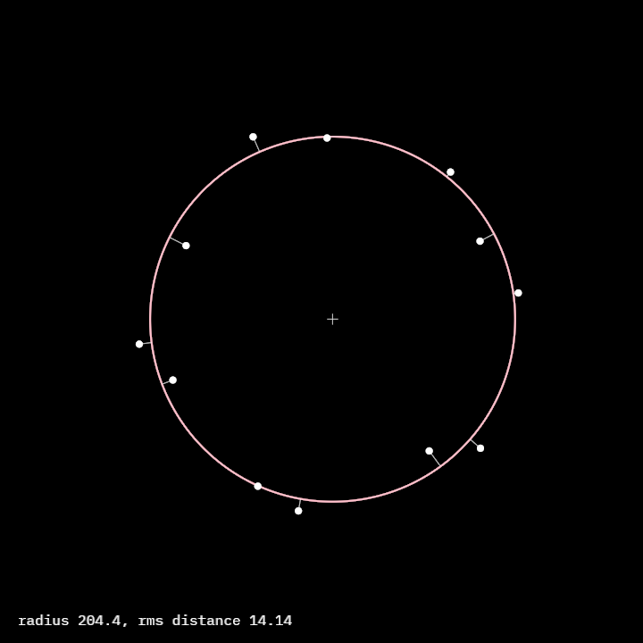

[source code](src/jvmDemo/kotlin/DemoDragFit01.kt)

### DemoDragGridWarp01

A grid warped by a twist and a scale: every point turns around the center by the twist times its distance to the
center, and its distance is scaled. Dragging any point of the grid changes the twist and the scale, see
[DragParameters].

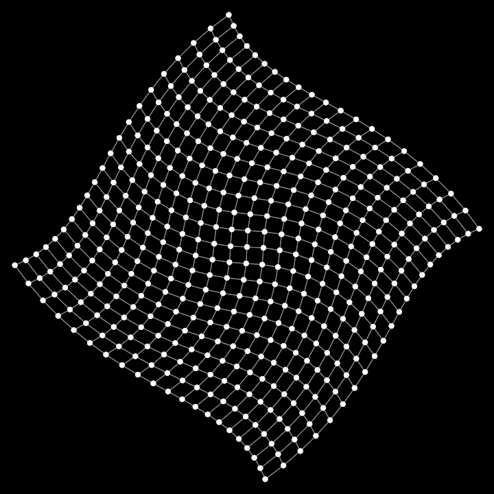

[source code](src/jvmDemo/kotlin/DemoDragGridWarp01.kt)

### DemoDragHyperbolic01

The tiling of the hyperbolic plane by heptagons, three around every corner, in the Poincaré disk, seen through a
Möbius transformation of three parameters: a translation inside the disk and a rotation. Dragging any corner, or
any other place of the plane, changes the transformation, see [DragParameters], so that place follows the mouse and
the tiling slides along with it: easily near the center, hardly near the rim, which is infinitely far away in the
hyperbolic plane.

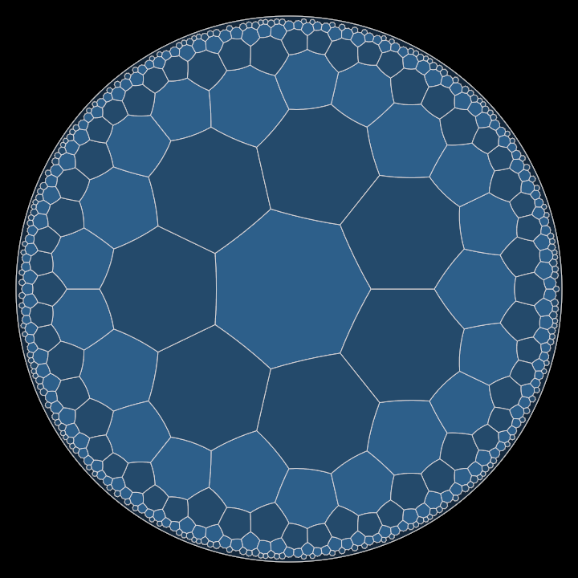

[source code](src/jvmDemo/kotlin/DemoDragHyperbolic01.kt)

### DemoDragImage01

An image of three parameters, its center and its scale: dragging the center moves it, dragging its corner scales
it around its center, see [DragParameters]. [DragParameters.affects] makes the center change the position only and
the corner the scale only.

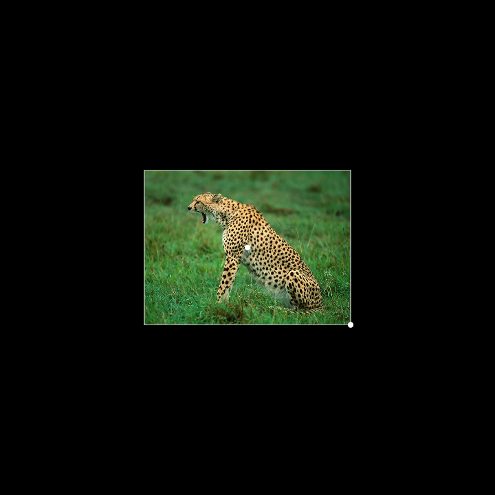

[source code](src/jvmDemo/kotlin/DemoDragImage01.kt)

### DemoDragLetters01

Parametric letters: the word HILT of five parameters that all its letters share, the width of a letter, the
height of the capitals, the weight of the stems, the height of the bars and the slant, all in pixels. Every corner
of every letter can be dragged, see [DragParameters], which changes the parameters that change least to bring it to
the mouse: dragging the inside of a stem makes the letters bolder, the top of a letter taller, a corner sideways
wider or more slanted, and the whole word follows.

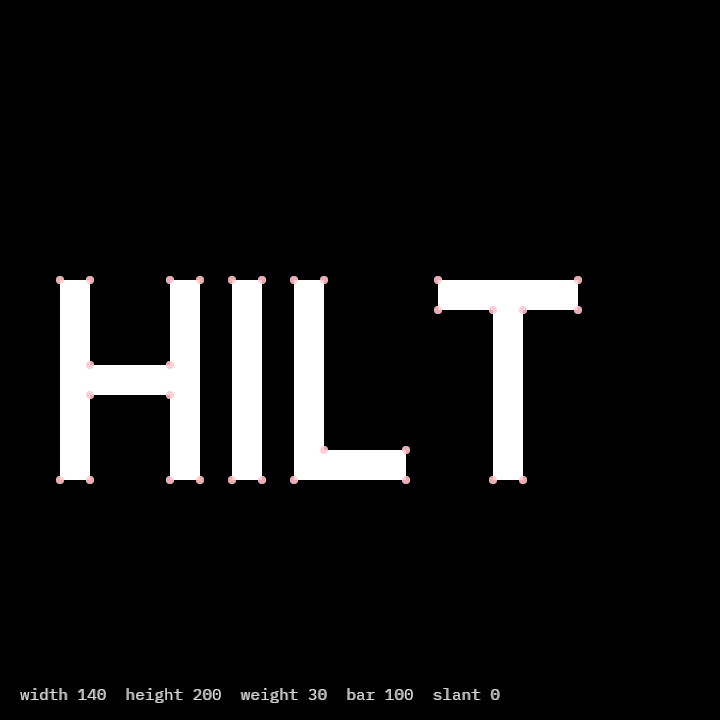

[source code](src/jvmDemo/kotlin/DemoDragLetters01.kt)

### DemoDragLinkage01

A four-bar linkage, of two parameters, the angles of the crank and of the coupler: that the coupler reaches the
rocker is not built in, it is a penalty that is minimized with everything else, see [DragParameters.penalty], so
the same gradient descent that follows the mouse keeps the linkage closed. The crank turns on its own while nothing
is dragged; dragging the crank pin, the end of the coupler or the point on the coupler turns the linkage to the
mouse, as far as it can go. The point on the coupler draws the coupler curve.

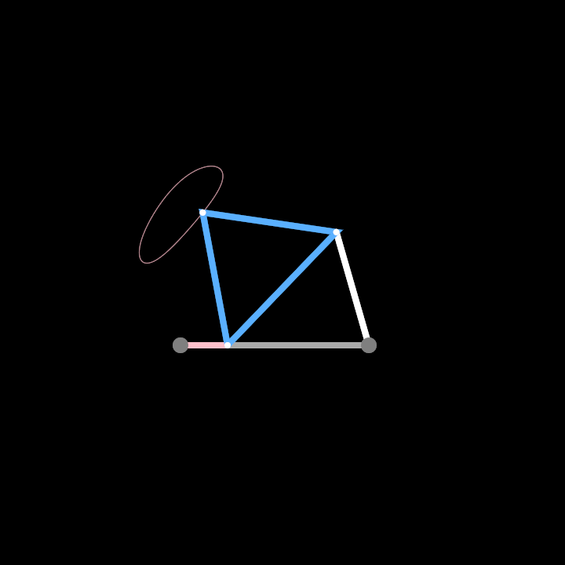

[source code](src/jvmDemo/kotlin/DemoDragLinkage01.kt)

### DemoDragLoxodromic01

A loxodromic Möbius transformation: it moves every point away from one fixed point, the source, and towards the
other, the sink, while turning around them, by a complex multiplier k. In coordinates where the source is 0 and
the sink infinity it is multiplication by k, so chains of circles, each the image of the one before, spiral out of
the source into the sink, along loxodromes.

The parameters are the two fixed points, the logarithm of the size of k, the angle of k and the size of the seed
circles. The fixed points can be dragged, the centers of the first images of the seed change k, the rim of a seed
circle its size, see [DragParameters] and [DragParameters.affects].

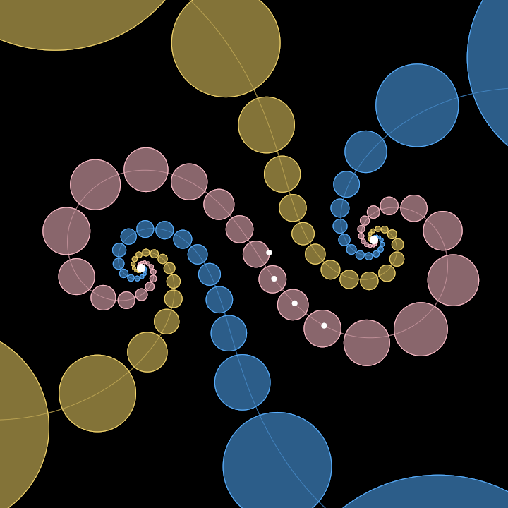

[source code](src/jvmDemo/kotlin/DemoDragLoxodromic01.kt)

### DemoDragMagnets01

Magnetic field lines of three bar magnets, each two poles of opposite strength of which the field falls off with the
distance, as it does in two dimensions; the lines are followed from around every north pole until they reach a
south pole or leave the window. Compasses at fixed places point along the field.

The parameters are where the magnets are and how they are turned. The center of a magnet moves it, its north pole
turns it, see [DragParameters.affects]; the needle of a compass can be dragged too, which moves and turns the magnets,
as little as they can, such that the field at the compass points to the mouse.

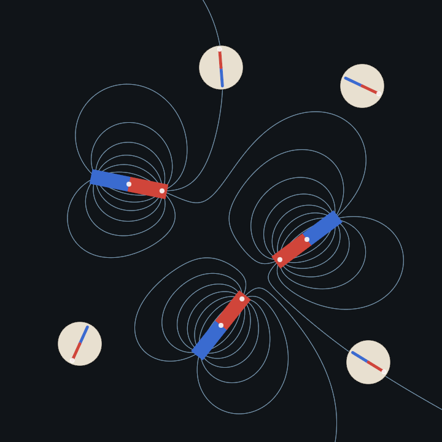

[source code](src/jvmDemo/kotlin/DemoDragMagnets01.kt)

### DemoDragMirror01

Two points of the parameters x and y, one at (x, y) and one at (y, x): dragging either one changes x and y by
gradient descent, see [DragParameters], so the other one follows, mirrored in the diagonal.

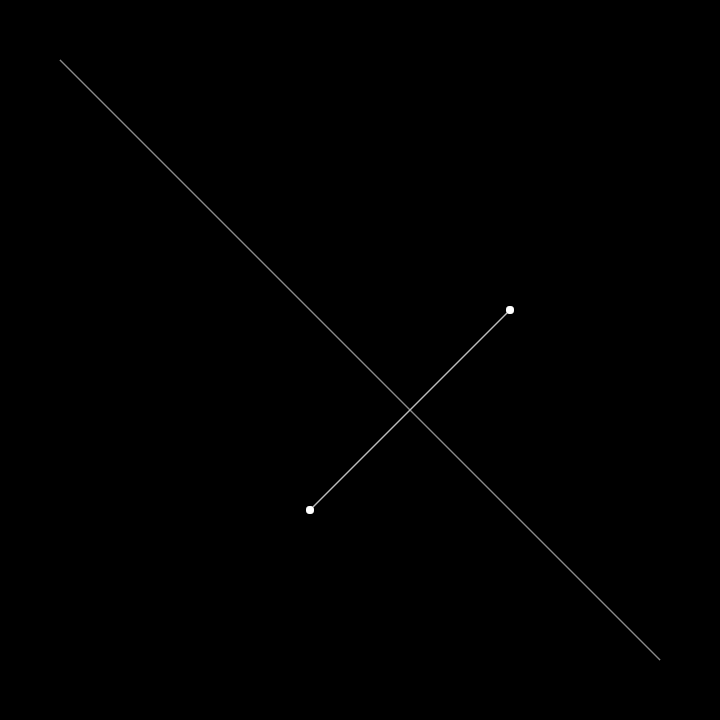

[source code](src/jvmDemo/kotlin/DemoDragMirror01.kt)

### DemoDragPenrose01

A Penrose tiling as the projection of five dimensions: de Bruijn's pentagrid, five families of parallel lines
shifted by a vector γ of five dimensions, gives a rhombus for every crossing of two lines, and every corner of the
rhombi a point K of the lattice of five dimensions, which the projection P, of five vectors in the plane, puts at
P K. The rhombi of the families of lines next to each other are thick, the others thin.

The parameters are the projection, the five vectors, ten numbers: any corner of any rhombus can be dragged, which
changes the projection as little as it can to put the corner at the mouse, see [DragParameters], and so all edges
of the same family together; the five vectors themselves are the star at the lower left. The shift γ changes the
tiling itself, not smoothly, so it is not dragged: the space bar moves it through five dimensions, and the rhombi
flip where the lines cross differently.

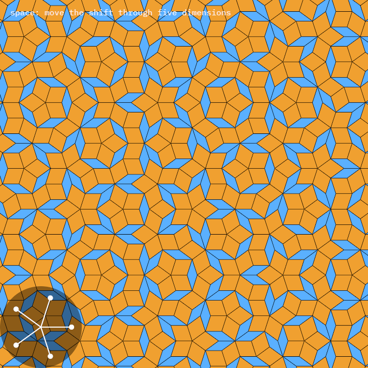

[source code](src/jvmDemo/kotlin/DemoDragPenrose01.kt)

### DemoDragQuasicrystal01

A quasicrystal as a density: the sum of N plane waves of the same wavelength in N directions around the circle,
of which the bright spots, the atoms, have N-fold symmetry but repeat nowhere when N is not 3, 4 or 6, which give
crystals. The arrow keys change N.

The parameters are the phases of the waves. A bright spot can be dragged, see [DragParameters.grab]: the phases
change as little as they can to move it to the mouse, which shifts the pattern partly and rearranges it partly,
a phason. Where the spot is for some phases is found by Newton's method, climbing the density from where it was.

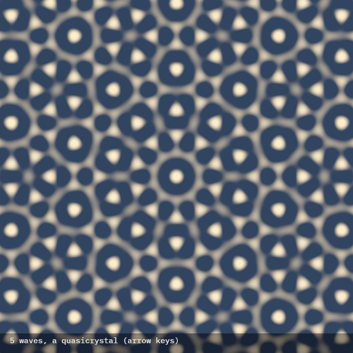

[source code](src/jvmDemo/kotlin/DemoDragQuasicrystal01.kt)

### DemoDragRings01

Two rings of ten points of a radius and an angle: the outer ring at the radius, turned by the angle, the inner ring
at half the radius, turned the other way. Dragging any point turns and scales both rings, see [DragParameters].

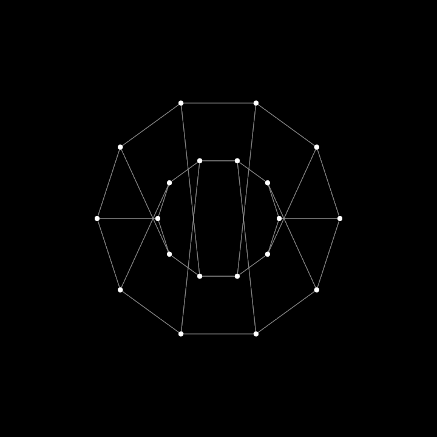

[source code](src/jvmDemo/kotlin/DemoDragRings01.kt)

### DemoDragStereographic01

The stereographic projection: a sphere with an icosahedron on it, left, and its projection from the north pole onto
the plane of the equator, right, which maps circles on the sphere to circles in the plane, so the edges of the
icosahedron, arcs of great circles, become arcs of circles. Turning the sphere moves the projection by a Möbius
transformation.

The parameters are the turn of the sphere, as an axis times an angle. Any point of the sphere can be grabbed, in
either view, see [DragParameters.grab]: the sphere turns, as little as it can, to bring that point to the mouse.

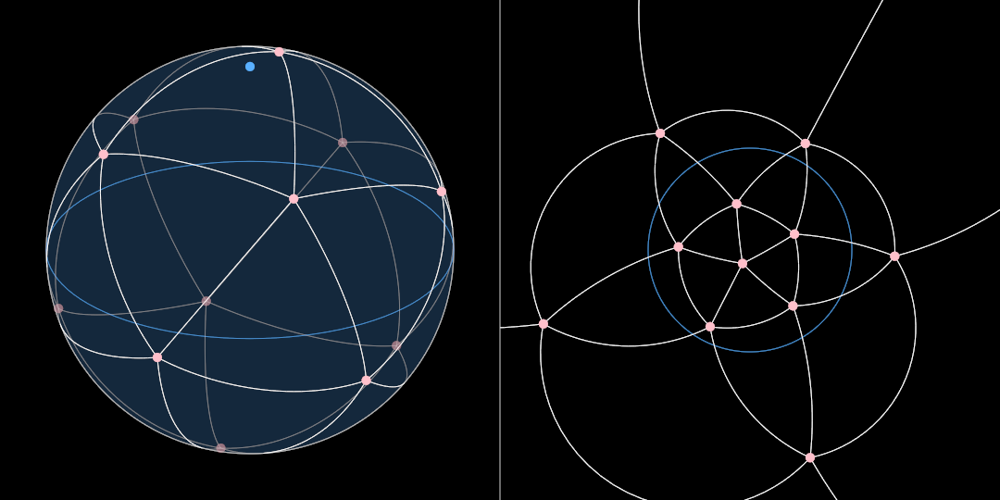

[source code](src/jvmDemo/kotlin/DemoDragStereographic01.kt)

### DemoDragTree01

A tree of branches that split in two, eight times: every branch is the attenuation times as long as the branch it
grows from, and turns the spread angle to the left or the right of it. Dragging the tip of any branch changes the
spread, the attenuation and the length of the trunk, see [DragParameters].

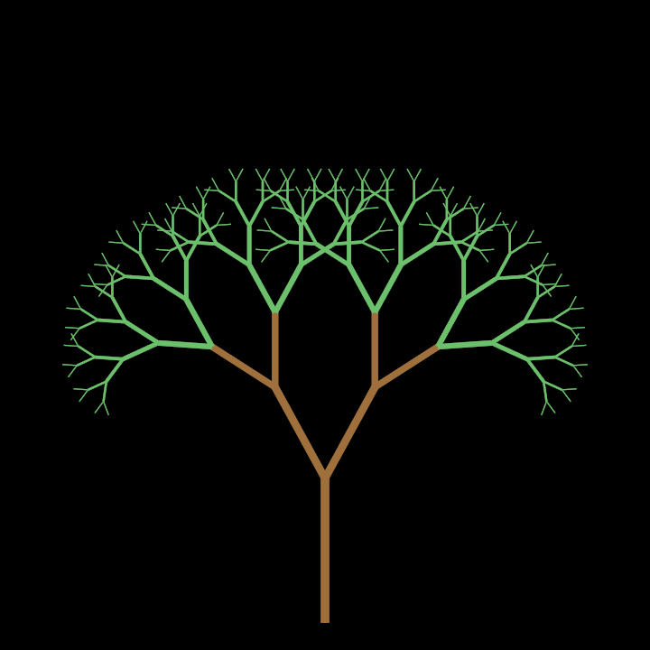

[source code](src/jvmDemo/kotlin/DemoDragTree01.kt)

### DemoDragTurtle01

The path of a turtle that walks 40 steps, each step a stride longer than the one before, and turns by an angle
after every step. Dragging any corner of the path changes the stride and the angle, see [DragParameters], which
gives spirals, stars and everything in between.

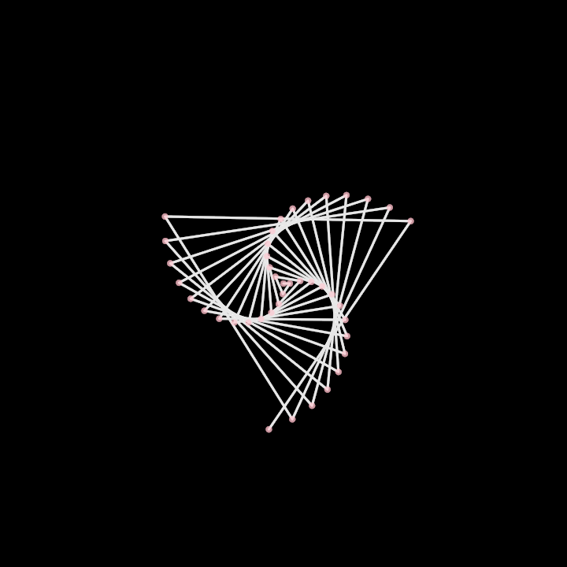

[source code](src/jvmDemo/kotlin/DemoDragTurtle01.kt)
