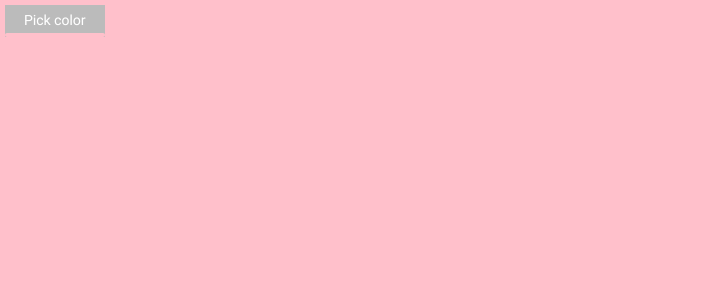
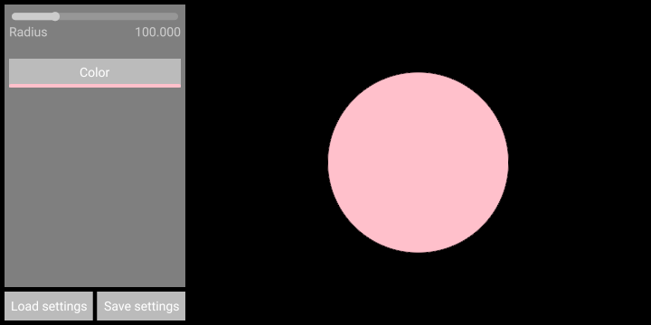
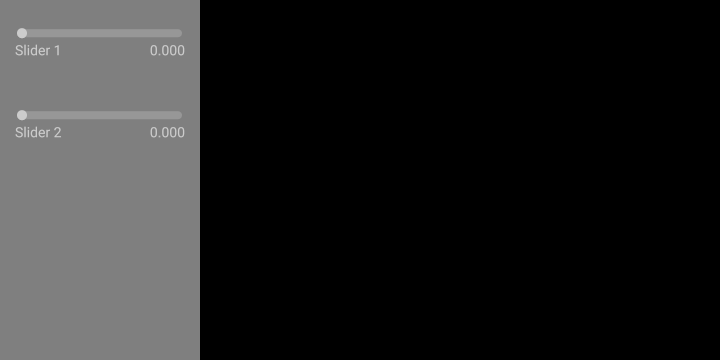
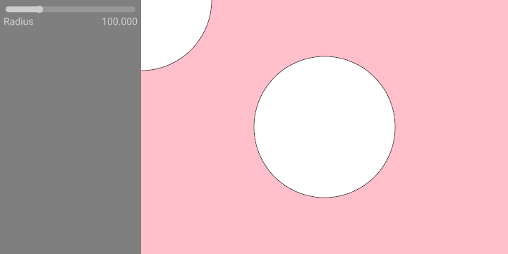
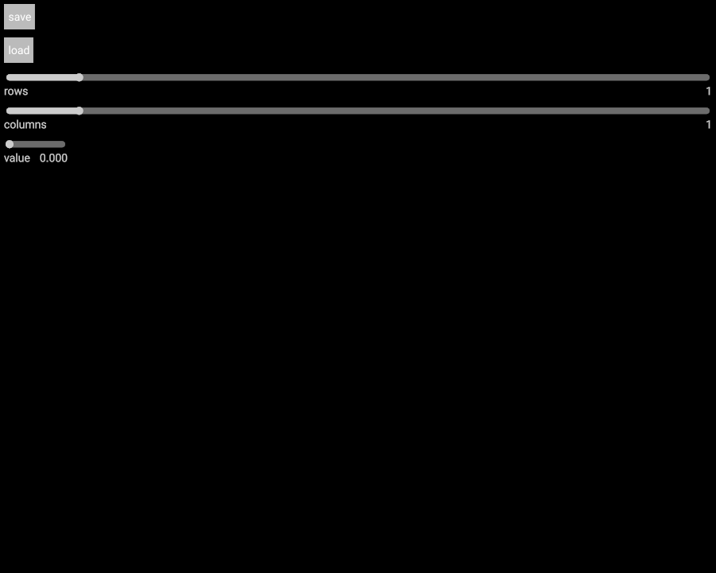

# orx-panel

The OPENRNDR UI toolkit. Provides buttons, sliders, text, a color picker and much more. HTML/CSS-like.

## Styles

Elements are styled by style sheets, which select elements like CSS does. Write them with the Kotlin builder or as
CSS:

```kotlin
controlManager {
    styleSheet(has class_ "toolbar") {
        display = Display.FLEX
        child(has type "button") { width = 80.px }
    }
    css("""
        .toolbar { --accent: #5ab0ff; gap: 4px; padding: 4px 8px }
        .toolbar > button:hover { background-color: var(--accent) }
        .panel :not(.toolbar) button:first-child { border: 1px solid white !important }
    """)
    layout { /* ... */ }
}
```

Selectors are those of CSS (types, classes, ids, states such as `:hover` and `:focus`, structural pseudo-classes like
`:nth-child()`, `:not()`, `:is()` and `:where()`, and all combinators), with the specificity of CSS. Properties take
CSS values and shorthands, `!important`, the keywords `inherit`, `initial` and `unset`, and custom properties with
`var()`. Inline styles take CSS too: `style = StyleSheet().apply { css("width: 50%; margin: 4px") }`. In CSS, grid
lines are counted from 1; the Kotlin builder counts grid tracks from 0.

Attribute selectors select the attributes of elements, like the labels of controls, `button[label="Delete"]`, and
those that are set with `setAttribute`, like `data-kind`. States are pseudo-classes: `:hover`, `:active`, `:focus`,
`:focus-visible`, `:focus-within`, `:disabled`, `:selected` and `:checked` for toggles that are on.

Backgrounds take gradients, `background: linear-gradient(135deg, #ff7e5f, #feb47b)`, `radial-gradient()` and their
repeating variants, and boxes take shadows, `box-shadow: 0 8px 24px rgb(0 0 0 / 0.4)`. `transform`, like
`translateY(-4px) scale(1.05)`, transforms an element and its descendants around `transform-origin`, without changing
the layout. `@keyframes` rules animate elements with `animation: pulse 1.2s ease-in-out infinite` and the
`animation-*` properties. An element's own background color is drawn over its gradient: `background: <gradient>` makes
the color transparent.

`@media` rules apply by the size of the window and the color scheme of the control manager, `colorScheme`:
`@media (max-width: 700px)`, `(orientation: portrait)`, `(prefers-color-scheme: light)`. Lengths take `em`, `rem`,
`vw` and `vh`, and `calc()` mixes them with percentages. Flex items take `flex-basis`, `order` and `align-self`, boxes
`aspect-ratio`, and positioned elements `right`, `bottom` and `inset`. Text takes `letter-spacing`, `line-height`,
`white-space: nowrap`, `text-overflow: ellipsis` and `text-decoration`. Elements can have several animations, which
can be paused with `animation-play-state`; transitions move colors, numbers, lengths, transforms and shadows, and
`box-shadow` can be `inset`. Transformed elements are hovered and clicked where they are drawn, and clip their content
by their shape. `virtualList(items, rowHeight) { item, index -> … }` scrolls long lists, it builds only the rows in view.

## Components

- `richText { span { "plain " }; span("strong") { "bold" }; span("link") { "a link" } }`: a paragraph of spans in
  their own styles that wrap together; clicks on a span trigger its mouse events.
- `treeView(roots, childrenOf, label)`: a tree that expands and collapses with the pointer and the keyboard, with
  `events.selected`, `events.activated` and `events.toggled`.
- `dataTable(rows, columns)`: a table with a header that sorts by its columns and resizes them, and rows that select.
- `splitPane { first { … }; second { … } }`: two panes with a splitter between them, `vertical = true` above each
  other.
- `controlManager.dialog { … }`: a modal dialog that keeps the keyboard focus, closed by escape, a click outside it, or
  `close()`; `controlManager.toast("Saved")`: a notification that goes away by itself.
- `dock { panel("Scene") { … }; panel("Layers", DockZone.RIGHT) { … } }`: panels in groups of tabs and in splits.
  Dragging a tab onto another group docks the panel there, in the middle as a tab or at a side next to the group; a
  double click on a tab, or a drag out of the window, takes the panel into a window of its own, and closing that window
  docks it again.
- `menuBar { menu("File") { item("Save", "mod+s") { … }; separator(); submenu("Export") { … } } }`: menus with
  submenus and shortcuts. Their items are also commands: `controlManager.commands.add("Name", "mod+shift+n") { … }`
  adds more, and cmd/ctrl+K opens the command palette, which finds commands by fuzzy search. The GUI of orx-gui adds
  its actions and a command to go to each of its compartments.
- `timeline { track("x", ::x, 0.0..1.0) }`: tracks of keyframes that set the properties they are bound to as the
  playhead moves; the ruler scrubs, keyframes drag, a double click adds one, delete removes it, space plays.
- `knob { }`, `rangeSlider { }`, and sliders with `logarithmic = true` and `ticks`/`snapToTicks`. Number fields and
  sliders take arithmetic when a value is typed: `2*pi`, `_ + 1` for the value plus one, `50%` of the range.
- `curveEditor { }`: the cubic Bézier curve of a CSS timing function; `gradientEditor { }`: the stops of a gradient,
  dragged, added by a double click and removed by dragging them off, interpolated in sRGB, linear RGB or OKLab.

- `nodeEditor { add(GraphNode("blur", inputs, outputs), position); connect(a, 0, b, 0) }`: nodes with ports that are
  wired by dragging from an output to an input, moved, selected with a box and removed with delete; the wheel zooms,
  the middle button or alt pans.
- `textArea { highlighter = Highlighters.glsl }`: multi-line text with a selection, words, indentation, the clipboard,
  scrolling and line numbers, in the colors of a highlighter.
- `colorEditor { }`: a wheel of the hues and chromas of OKLCH, sliders of lightness, chroma, hue and alpha, a field
  that takes any CSS color, swatches that the editors share, and `controlManager.pickColor { }`, a pipette that picks a
  color from the window.
- `plot { watch("frame ms") { … } }`, `histogram { }` and `scope { }`: live graphs of values, distributions and
  waveforms.

Knobs, range sliders, number fields, the editors, color editors, text areas and timelines `bind(::property)` both ways:
a change in the control sets the property, and a change of the property, by anything, shows in the control.

The edits by the user, of the values of controls, keyframes, text, nodes and wires, the order of lists and the places
of panels in docks, go into `controlManager.history`, undone with mod+z and redone with mod+shift+z. The layout of a
dock is saved with `dock.layout()`, restored with `dock.restore(layout)`, and kept in a file between runs with
`dock.persist(file)`.

Menus are used with the keyboard: F10, or alt and the first letter of a menu on Windows and Linux, opens a menu of the
menu bar; the arrow keys go through the items and the menus, enter calls an item, typing goes to the item that starts
with the letter, and escape closes the menu.

Rows of lists slide to their new places when the items change, groups of docks when panels are docked elsewhere, tabs
fade in their pages, and a double click on a splitter moves it to the middle; `element.animateMoveFrom(position)`,
`element.fadeIn()` and `controlManager.animate(element, duration) { t -> … }` animate other elements.

Rows of a `virtualList` and a `dataTable` with `reorderable = true`, and items of a `treeView` with `draggable = true`
are moved by dragging them; any element takes part in drag and drop with `dnd.data`, `dnd.accepts` and the events of
`dnd`, the source is `:dragging` and the target under the pointer `:drag-over`.

Trees and tables build only the rows in view, like `virtualList`. Controls in transformed elements get the positions
under the pointer in their own coordinates, and changes inside elements of fixed sizes lay out only those elements.

The default styles take their colors and sizes from custom properties, a theme: override them in a later style sheet,
like `:root { --control-background: #3a4150; --control-font-size: 16px }`, see `panelThemeCss`. Style sheets can be read
from CSS files with `cssFile("ui.css")`, which are read again when they change while the program runs.

F12 shows the inspector: the element under the pointer is highlighted with its margin, border, padding and content, and
a window of its own shows its path, the rules that select it in the order of the cascade, with the declarations that
are overridden struck through, and its computed style. Shift-F12 pins the element, F12 again or closing the window
hides the inspector. With `inspector.inWindow = false` the inspector is drawn over the window instead.

<!-- __demos__ -->
## Demos
### DemoBinding01

Demonstrates how to create a UI with two sliders and a button, and how to bind
the value of the sliders with properties of an object's instance.

`styleSheet` is used to control the looks and placement of the inputs
(equivalent to CSS in web pages) and `layout` represents the content of the UI,
including names, ID and slider ranges (equivalent to HTML in web pages).


[source code](src/demo/kotlin/DemoBinding01.kt)

### DemoColorPickerButton01

A simple demonstration of a ColorPickerButton



[source code](src/demo/kotlin/DemoColorPickerButton01.kt)

### DemoComplex01

Demonstrates how to create a UI with a drop-down menu. When an option is picked,
the content of a Div is replaced by a button and some sliders.


[source code](src/demo/kotlin/DemoComplex01.kt)

### DemoGridLayout01

Demonstrates the use of grid layouts.

The program creates a grid of 2 columns and 4 rows. The first two rows are merged together by using
`gridPopulation { 2.columns }`.


[source code](src/demo/kotlin/DemoGridLayout01.kt)

### DemoHorizontalLayout01

Demonstrates how to create a `styleSheet` using `Display.FLEX` and `FlexDirection.Row`
to create a horizontal layout featuring 10 clickable buttons with various colors.

The `controlManager { }` DSL includes `styleSheet { }`, which uses a syntax inspired
by CSS, and `layout { }`, which is structured similarly to HTML.


[source code](src/demo/kotlin/DemoHorizontalLayout01.kt)

### DemoSimpleUI01

Demonstrates the use of grid layouts, property-control binding, and JSON serialization/deserialization for
model persistence.



[source code](src/demo/kotlin/DemoSimpleUI01.kt)

### DemoToolWindows01

Demonstrates how to create a simple UI with a button to open a secondary tool window with multiple sliders.

A `hitTest` area at the top of the tool window makes it possible to drag it with the mouse.

The tool window can be closed by clicking its `close` button, or by pressing the ESC key.


[source code](src/demo/kotlin/DemoToolWindows01.kt)

### DemoVerticalLayout01

Demonstrates how `Display.FLEX` can be used to create vertical arrangements by
using `FlexDirection.Column` instead of `FlexDirection.Row`.

The program also shows common `styleSheet` properties to control `width`, `height`,
padding and background color.



[source code](src/demo/kotlin/DemoVerticalLayout01.kt)

### DemoViewBoxElement01

This demonstration shows how `ViewBox` (from `orx-view-box`) can be embedded as a document element within the panel layout system,
allowing OPENRNDR drawing operations to be integrated alongside other UI components in a grid layout.
The ViewBox element responds interactively to UI controls (slider) and mouse input.



[source code](src/demo/kotlin/DemoViewBoxElement01.kt)

### DemoViewBoxElement02

This demonstration shows how a previously defined `ViewBox` (from `orx-view-box`) can be embedded as a document element within the panel layout system,
allowing OPENRNDR drawing operations to be integrated alongside other UI components in a grid layout.
The ViewBox element responds interactively to UI controls (slider) and mouse input.


[source code](src/demo/kotlin/DemoViewBoxElement02.kt)

### DemoWatchDiv01

Demonstrates how to create a GUI with a persistent state (can be saved and loaded)
and a variable number of inputs arranged in a grid. The user can adjust
the number of columns and rows of the grid, and each cell features a slider
to control its value between 0.0 and 10.0 (the default range).



[source code](src/demo/kotlin/DemoWatchDiv01.kt)

### DemoWatchObjectDiv01

A demonstration of `watchObjectDiv`.

`watchObjecDiv` creates a Div element with the provided `classes`, and runs a `builder` function
to populate the Div any time the `watchObject` argument changes.

This demo creates a panel with two sliders bound to two integer values, representing the number of columns
and rows.

The `watchObjectDiv` expects three arguments: the classes to apply to the Div, an object to watch, and a
builder function to populate the Div object when the watched object changes.

The builder function creates a Div for every row, containing a Button for every column.
The label for each button is its coordinates. A `clicked` event is attached to the buttons to print
those coordinates.


[source code](src/demo/kotlin/DemoWatchObjectDiv01.kt)
