# orx-panel

The OPENRNDR UI toolkit. Provides buttons, sliders, text, a color picker and much more. HTML/CSS-like.

## Styles

Elements are styled by style sheets, which select elements like CSS does. Write them with the Kotlin builder or as
CSS:

```kotlin
controlManager {
    styleSheet(has class_ "toolbar") {
        display = Display.FLEX
        child(has type "button") { width = 80.px }
    }
    css("""
        .toolbar { --accent: #5ab0ff; gap: 4px; padding: 4px 8px }
        .toolbar > button:hover { background-color: var(--accent) }
        .panel :not(.toolbar) button:first-child { border: 1px solid white !important }
    """)
    layout { /* ... */ }
}
```

Selectors are those of CSS (types, classes, ids, states such as `:hover` and `:focus`, structural pseudo-classes like
`:nth-child()`, `:not()`, `:is()` and `:where()`, and all combinators), with the specificity of CSS. Properties take
CSS values and shorthands, `!important`, the keywords `inherit`, `initial` and `unset`, and custom properties with
`var()`. Inline styles take CSS too: `style = StyleSheet().apply { css("width: 50%; margin: 4px") }`. In CSS, grid
lines are counted from 1; the Kotlin builder counts grid tracks from 0.

Attribute selectors select the attributes of elements, like the labels of controls, `button[label="Delete"]`, and
those that are set with `setAttribute`, like `data-kind`. States are pseudo-classes: `:hover`, `:active`, `:focus`,
`:focus-visible`, `:focus-within`, `:disabled`, `:selected` and `:checked` for toggles that are on.

Backgrounds take gradients, `background: linear-gradient(135deg, #ff7e5f, #feb47b)`, `radial-gradient()` and their
repeating variants, and boxes take shadows, `box-shadow: 0 8px 24px rgb(0 0 0 / 0.4)`. `transform`, like
`translateY(-4px) scale(1.05)`, transforms an element and its descendants around `transform-origin`, without changing
the layout. `@keyframes` rules animate elements with `animation: pulse 1.2s ease-in-out infinite` and the
`animation-*` properties. An element's own background color is drawn over its gradient: `background: <gradient>` makes
the color transparent.

`@media` rules apply by the size of the window and the color scheme of the control manager, `colorScheme`:
`@media (max-width: 700px)`, `(orientation: portrait)`, `(prefers-color-scheme: light)`. Lengths take `em`, `rem`,
`vw` and `vh`, and `calc()` mixes them with percentages. Flex items take `flex-basis`, `order` and `align-self`, boxes
`aspect-ratio`, and positioned elements `right`, `bottom` and `inset`. Text takes `letter-spacing`, `line-height`,
`white-space: nowrap`, `text-overflow: ellipsis` and `text-decoration`. Elements can have several animations, which
can be paused with `animation-play-state`; transitions move colors, numbers, lengths, transforms and shadows, and
`box-shadow` can be `inset`. Transformed elements are hovered and clicked where they are drawn, and clip their content
by their shape. `virtualList(items, rowHeight) { item, index -> … }` scrolls long lists, it builds only the rows in view.

## Components

- `richText { span { "plain " }; span("strong") { "bold" }; span("link") { "a link" } }`: a paragraph of spans in
  their own styles that wrap together; clicks on a span trigger its mouse events.
- `treeView(roots, childrenOf, label)`: a tree that expands and collapses with the pointer and the keyboard, with
  `events.selected`, `events.activated` and `events.toggled`.
- `dataTable(rows, columns)`: a table with a header that sorts by its columns and resizes them, and rows that select.
- `splitPane { first { … }; second { … } }`: two panes with a splitter between them, `vertical = true` above each
  other.
- `controlManager.dialog { … }`: a modal dialog that keeps the keyboard focus, closed by escape, a click outside it, or
  `close()`; `controlManager.toast("Saved")`: a notification that goes away by itself.
- `dock { panel("Scene") { … }; panel("Layers", DockZone.RIGHT) { … } }`: panels in groups of tabs and in splits.
  Dragging a tab onto another group docks the panel there, in the middle as a tab or at a side next to the group; a
  double click on a tab, or a drag out of the window, takes the panel into a window of its own, and closing that window
  docks it again.
- `menuBar { menu("File") { item("Save", "mod+s") { … }; separator(); submenu("Export") { … } } }`: menus with
  submenus and shortcuts. Their items are also commands: `controlManager.commands.add("Name", "mod+shift+n") { … }`
  adds more, and cmd/ctrl+K opens the command palette, which finds commands by fuzzy search. The GUI of orx-gui adds
  its actions and a command to go to each of its compartments.
- `timeline { track("x", ::x, 0.0..1.0) }`: tracks of keyframes that set the properties they are bound to as the
  playhead moves; the ruler scrubs, keyframes drag, a double click adds one, delete removes it, space plays.
- `knob { }`, `rangeSlider { }`, and sliders with `logarithmic = true` and `ticks`/`snapToTicks`. Number fields and
  sliders take arithmetic when a value is typed: `2*pi`, `_ + 1` for the value plus one, `50%` of the range.
- `curveEditor { }`: the cubic Bézier curve of a CSS timing function; `gradientEditor { }`: the stops of a gradient,
  dragged, added by a double click and removed by dragging them off, interpolated in sRGB, linear RGB or OKLab.

- `nodeEditor { add(GraphNode("blur", inputs, outputs), position); connect(a, 0, b, 0) }`: nodes with ports that are
  wired by dragging from an output to an input, moved, selected with a box and removed with delete; the wheel zooms,
  the middle button or alt pans.
- `textArea { highlighter = Highlighters.glsl }`: multi-line text with a selection, words, indentation, the clipboard,
  scrolling and line numbers, in the colors of a highlighter, and `marks` that underline parts of the text with their
  messages as tooltips.
- `expressionArea { check = { checkTypedExpression(it, setOf("t")) } }`: a text area for the expressions and programs
  of orx-expression-evaluator and orx-expression-evaluator-typed, which colors their tokens, marks the problems that
  `check` finds while typing, and those of an evaluation with `report(exception)`.
- `colorEditor { }`: a wheel of the hues and chromas of OKLCH, sliders of lightness, chroma, hue and alpha, a field
  that takes any CSS color, swatches that the editors share, and `controlManager.pickColor { }`, a pipette that picks a
  color from the window.
- `plot { watch("frame ms") { … } }`, `histogram { }` and `scope { }`: live graphs of values, distributions and
  waveforms.

- `fcurveEditor { value = curve }`: edits an `FCurve` of orx-fcurve, also long and complex ones. It zooms horizontally
  with the wheel and vertically with shift and the wheel; its tools select and move keys and their Bézier handles,
  cut the curve, break it into jumps and join them, and sculpt it under a brush of a radius with grab, smooth, flatten
  and noise, and simplify the selection by fitting it again with fewer Bézier segments. Sculpting only moves values and fits the curve again with the distortion of orx-shapes, so the curve stays
  a function of time, and smoothing keeps the jumps.

Knobs, range sliders, number fields, the editors, color editors, text areas and timelines `bind(::property)` both ways:
a change in the control sets the property, and a change of the property, by anything, shows in the control.

The edits by the user, of the values of controls, keyframes, text, nodes and wires, the order of lists and the places
of panels in docks, go into `controlManager.history`, undone with mod+z and redone with mod+shift+z. The layout of a
dock is saved with `dock.layout()`, restored with `dock.restore(layout)`, and kept in a file between runs with
`dock.persist(file)`.

Menus are used with the keyboard: F10, or alt and the first letter of a menu on Windows and Linux, opens a menu of the
menu bar; the arrow keys go through the items and the menus, enter calls an item, typing goes to the item that starts
with the letter, and escape closes the menu.

Rows of lists slide to their new places when the items change, groups of docks when panels are docked elsewhere, tabs
fade in their pages, and a double click on a splitter moves it to the middle; `element.animateMoveFrom(position)`,
`element.fadeIn()` and `controlManager.animate(element, duration) { t -> … }` animate other elements.

Rows of a `virtualList` and a `dataTable` with `reorderable = true`, and items of a `treeView` with `draggable = true`
are moved by dragging them; any element takes part in drag and drop with `dnd.data`, `dnd.accepts` and the events of
`dnd`, the source is `:dragging` and the target under the pointer `:drag-over`.

Trees and tables build only the rows in view, like `virtualList`. Controls in transformed elements get the positions
under the pointer in their own coordinates, and changes inside elements of fixed sizes lay out only those elements.

The default styles take their colors and sizes from custom properties, a theme: override them in a later style sheet,
like `:root { --control-background: #3a4150; --control-font-size: 16px }`, see `panelThemeCss`. Style sheets can be read
from CSS files with `cssFile("ui.css")`, which are read again when they change while the program runs.

F12 shows the inspector: the element under the pointer is highlighted with its margin, border, padding and content, and
a window of its own shows its path, the rules that select it in the order of the cascade, with the declarations that
are overridden struck through, and its computed style. Shift-F12 pins the element, F12 again or closing the window
hides the inspector. With `inspector.inWindow = false` the inspector is drawn over the window instead.

<!-- __demos__ -->
## Demos
### DemoBinding01

Demonstrates how to create a UI with two sliders and a button, and how to bind
the value of the sliders with properties of an object's instance.

`styleSheet` is used to control the looks and placement of the inputs
(equivalent to CSS in web pages) and `layout` represents the content of the UI,
including names, ID and slider ranges (equivalent to HTML in web pages).

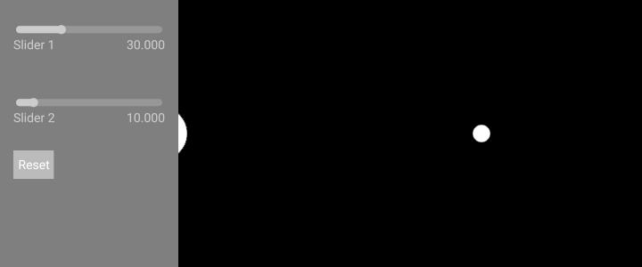

[source code](src/demo/kotlin/DemoBinding01.kt)

### DemoColorPickerButton01

A simple demonstration of a ColorPickerButton


[source code](src/demo/kotlin/DemoColorPickerButton01.kt)

### DemoComplex01

Demonstrates how to create a UI with a drop-down menu. When an option is picked,
the content of a Div is replaced by a button and some sliders.


[source code](src/demo/kotlin/DemoComplex01.kt)

### DemoComponents01

Demonstrates the components of panels: a split pane with a tree on the left and a table on the right, rich text with
spans in their own styles and a link, a dialog that keeps the keyboard focus, and toasts.

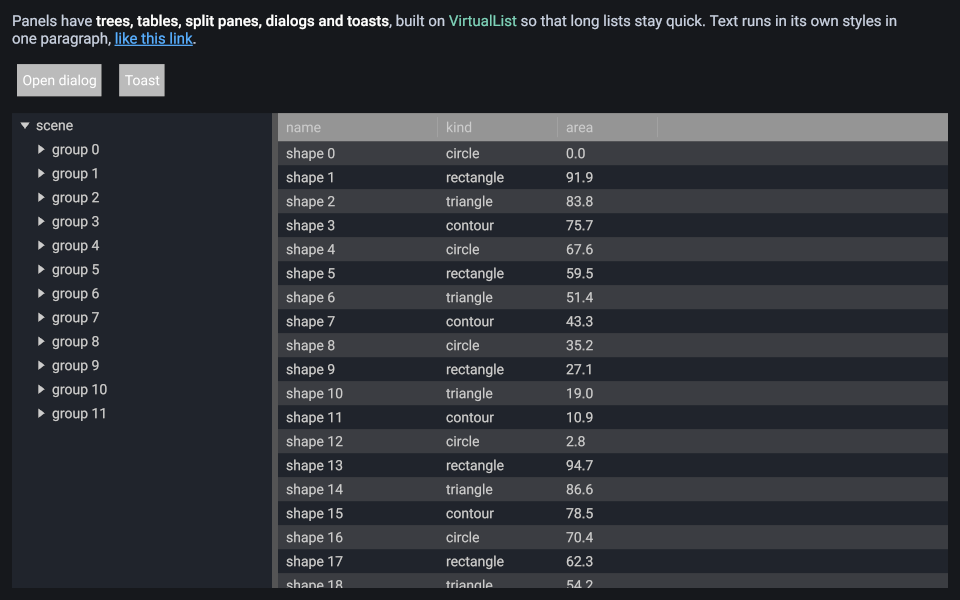

[source code](src/demo/kotlin/DemoComponents01.kt)

### DemoComponents02

Demonstrates the tools of panels: a menu bar whose items are also commands in the command palette (cmd/ctrl+K),
panels in a dock that are dragged by their tabs into other groups and out of the window, a knob, a range slider, a
logarithmic slider with ticks, number fields that take arithmetic, a curve editor, a gradient editor, a list that is
reordered by dragging and a timeline of keyframes that animates the drawing. The knobs, the number field and the curve
editor are bound to the values of the drawing both ways, so they follow the timeline; the layout of the dock is kept
between runs, and edits are undone with mod+z.

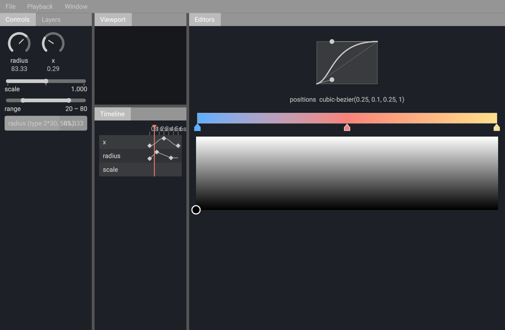

[source code](src/demo/kotlin/DemoComponents02.kt)

### DemoComponents03

Demonstrates more tools of panels, in a dock: a node editor of a small graph, with ports colored by their types,
a live value on a port, a node with a body that draws a wave, a slider in the body of the mix node, and a status that
tells the output has no input; Graph > Compact nodes shows only the connected ports, and the wire from the time to
the radius of the blur goes around the nodes through waypoints. Hovering over a port highlights what leads to it or
what it leads to. A text area with the code of a shader
in highlighted GLSL, a color editor with a wheel in OKLCH, swatches and a pipette that picks colors from the window,
and live plots of the frame time and of values, a histogram and a scope. The edits are undone with mod+z, and the
menus are used with the keyboard: F10, then the arrow keys.

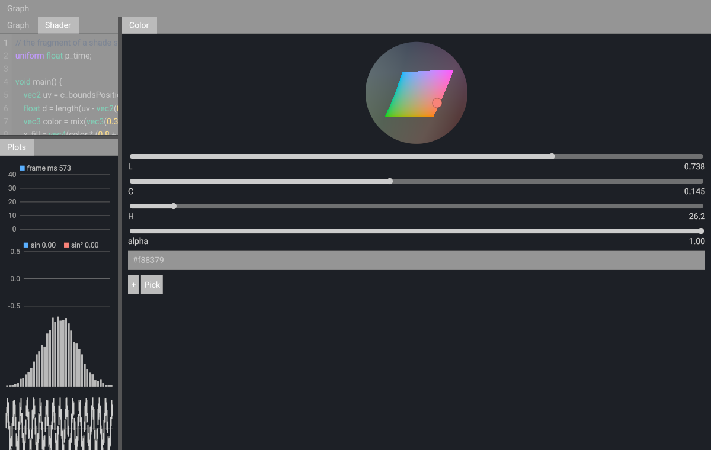

[source code](src/demo/kotlin/DemoComponents03.kt)

### DemoConsole01

Demonstrates a console for a small command language over circles: `add <color> at <x> <y> as <name>`,
`remove <name>`, `move <name> to <x> <y>` and `list`. Tab completes the commands, the colors and the names of the
circles from a list under the caret, the rest of the best candidate shows dimmed and right takes it. Words that
are not understood are underlined while typing, errors show under their span in the log, and up and down go
through the commands that were given.

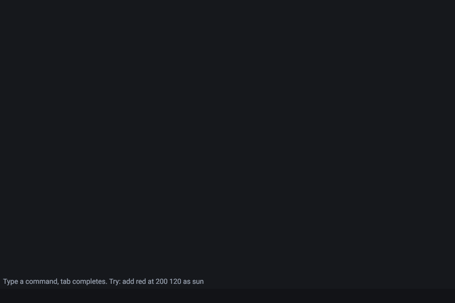

[source code](src/demo/kotlin/DemoConsole01.kt)

### DemoCss01

Demonstrates styling a user interface with CSS: selectors with classes, states and structural pseudo-classes,
shorthands, !important, and custom properties with var(). Hover the buttons to see their states.

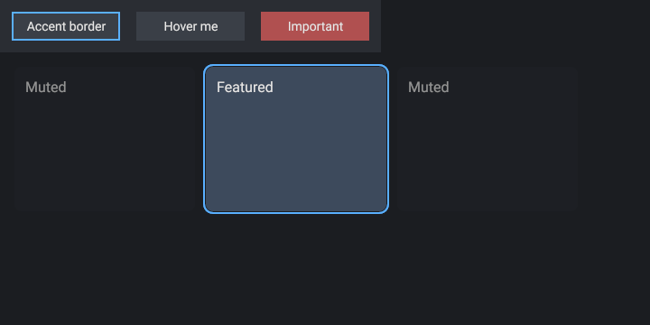

[source code](src/demo/kotlin/DemoCss01.kt)

### DemoCss02

Demonstrates the effects of CSS in panels: gradient backgrounds, box shadows, transforms that transition when the
cards are hovered, animations with @keyframes, and selectors of attributes and states, like `button[label="Delete"]`
and `toggle:checked`.

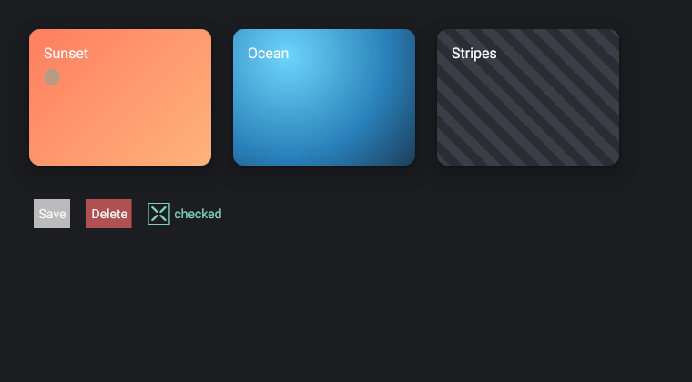

[source code](src/demo/kotlin/DemoCss02.kt)

### DemoCss03

Demonstrates more of CSS in panels: a media query that stacks the columns when the window is narrow and one for the
color scheme, text with letter spacing, an ellipsis and decorations, an inset shadow, a rotated box that clips its
scrolling content by its shape, flex items with a basis, an order and their own alignment, and a list of ten thousand
rows of which only the rows in view are built.

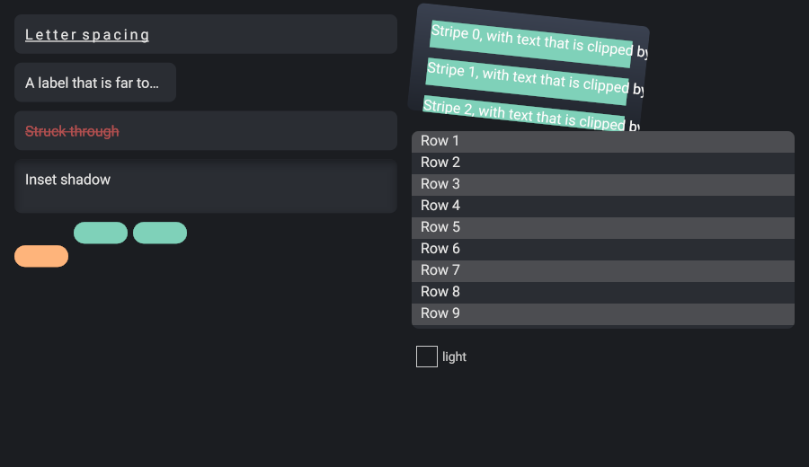

[source code](src/demo/kotlin/DemoCss03.kt)

### DemoFCurveEditor01

Demonstrates the editor of fcurves on a long curve of 600 keys over two minutes, with jumps here and there. The
view zooms horizontally with the wheel, vertically with shift and the wheel, and F frames the whole curve. The
tools: select and move keys and handles (V), add keys with the pen (P), draw the curve by hand (D), cut the curve
(C), break it into a jump (B), and sculpt it under a brush with grab (G), smooth (S), flatten (L) and noise (N);
[ and ] change the radius of the brush. Simplify (R) fits the curve between the selected keys again with fewer
segments, like after sculpting. Clear removes the curve, to build a new one with the pen or by drawing; the context
menu makes the selected keys smooth, linear or constant. The circle above the editor follows the curve at the
playhead, and mod+z undoes the edits.

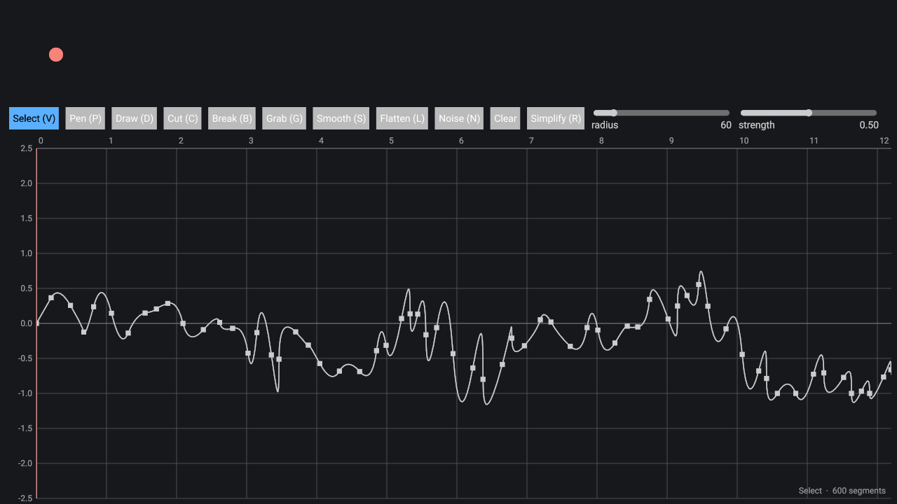

[source code](src/demo/kotlin/DemoFCurveEditor01.kt)

### DemoGridLayout01

Demonstrates the use of grid layouts.

The program creates a grid of 2 columns and 4 rows. The first two rows are merged together by using
`gridPopulation { 2.columns }`.

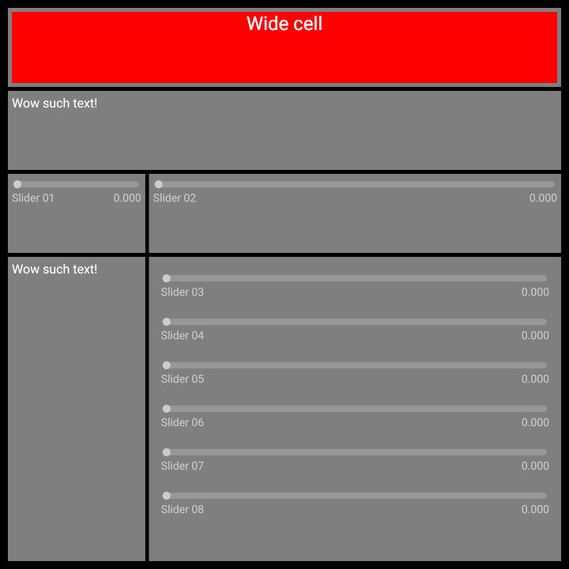

[source code](src/demo/kotlin/DemoGridLayout01.kt)

### DemoHorizontalLayout01

Demonstrates how to create a `styleSheet` using `Display.FLEX` and `FlexDirection.Row`
to create a horizontal layout featuring 10 clickable buttons with various colors.

The `controlManager { }` DSL includes `styleSheet { }`, which uses a syntax inspired
by CSS, and `layout { }`, which is structured similarly to HTML.

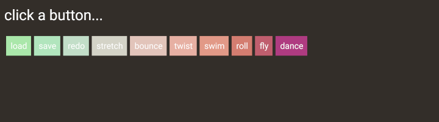

[source code](src/demo/kotlin/DemoHorizontalLayout01.kt)

### DemoScrolling01

Demonstrates scrolling: elements with `overflow = Overflow.Scroll` scroll content that does not fit them.

- the strip at the top is a row of tiles that do not shrink, it scrolls horizontally
- the area below is a grid that is wider and taller than the area, it scrolls both ways

Scroll with a trackpad or with the wheels of a mouse; with shift held a vertical wheel scrolls horizontally. The
scrollbars show how far the content is scrolled: drag a thumb to scroll, click a track to scroll by a page. They
show while scrolling and while the pointer is over them, and fade out after that; the strip keeps its scrollbar with
`scrollbarVisibility = ScrollbarVisibility.Always`. The strip styles its scrollbar with `scrollbarColor`,
`scrollbarTrackColor` and `scrollbarWidth`, which are inherited.

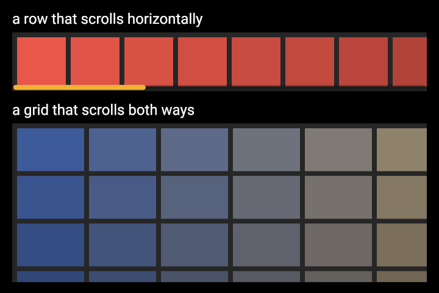

[source code](src/demo/kotlin/DemoScrolling01.kt)

### DemoSettings01

Demonstrates the styling and navigation of a list of settings:

- the list scrolls vertically only, `overflowX = Overflow.Hidden`, smoothly with the wheel and its scrollbar
- the headers of the sections are sticky: they stay at the top while their sections scroll by
- controls with rounded corners, `borderRadius`, whose colors change smoothly when hovered, `transitionDuration`
- the last section is faded with `opacity`
- tab and shift-tab move the keyboard focus between the controls, which shows a focus ring and scrolls the focused
control into view

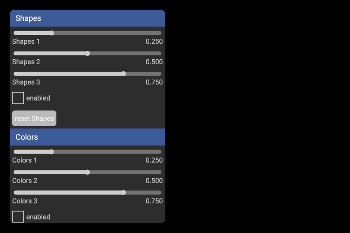

[source code](src/demo/kotlin/DemoSettings01.kt)

### DemoShadeStyleEditor01

A node based editor of shade styles. The nodes of the graph are pieces of GLSL with typed inputs and outputs, wired
into the color of the output node; the graph is compiled to the fragment transform of a shade style, which colors the
preview. The parameters of the nodes are uniforms of the shade style: a selected node shows sliders for its
parameters, which change the preview while they are dragged without compiling the shade style again; only adding,
removing and wiring nodes compiles it. The generated GLSL is shown, highlighted.

A right click on the graph adds a node where the pointer is, so does the Add menu in the middle of the graph; inputs
of different types are converted, an input without a wire takes its default, delete removes the selected nodes and
mod+z undoes the edits.

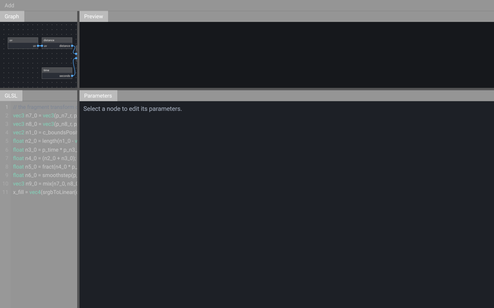

[source code](src/demo/kotlin/DemoShadeStyleEditor01.kt)

### DemoSimpleUI01

Demonstrates the use of grid layouts, property-control binding, and JSON serialization/deserialization for
model persistence.


[source code](src/demo/kotlin/DemoSimpleUI01.kt)

### DemoToolWindows01

Demonstrates how to create a simple UI with a button to open a secondary tool window with multiple sliders.

A `hitTest` area at the top of the tool window makes it possible to drag it with the mouse.

The tool window can be closed by clicking its `close` button, or by pressing the ESC key.


[source code](src/demo/kotlin/DemoToolWindows01.kt)

### DemoVerticalLayout01

Demonstrates how `Display.FLEX` can be used to create vertical arrangements by
using `FlexDirection.Column` instead of `FlexDirection.Row`.

The program also shows common `styleSheet` properties to control `width`, `height`,
padding and background color.


[source code](src/demo/kotlin/DemoVerticalLayout01.kt)

### DemoViewBoxElement01

This demonstration shows how `ViewBox` (from `orx-view-box`) can be embedded as a document element within the panel layout system,
allowing OPENRNDR drawing operations to be integrated alongside other UI components in a grid layout.
The ViewBox element responds interactively to UI controls (slider) and mouse input.


[source code](src/demo/kotlin/DemoViewBoxElement01.kt)

### DemoViewBoxElement02

This demonstration shows how a previously defined `ViewBox` (from `orx-view-box`) can be embedded as a document element within the panel layout system,
allowing OPENRNDR drawing operations to be integrated alongside other UI components in a grid layout.
The ViewBox element responds interactively to UI controls (slider) and mouse input.


[source code](src/demo/kotlin/DemoViewBoxElement02.kt)

### DemoWatchDiv01

Demonstrates how to create a GUI with a persistent state (can be saved and loaded)
and a variable number of inputs arranged in a grid. The user can adjust
the number of columns and rows of the grid, and each cell features a slider
to control its value between 0.0 and 10.0 (the default range).


[source code](src/demo/kotlin/DemoWatchDiv01.kt)

### DemoWatchObjectDiv01

A demonstration of `watchObjectDiv`.

`watchObjecDiv` creates a Div element with the provided `classes`, and runs a `builder` function
to populate the Div any time the `watchObject` argument changes.

This demo creates a panel with two sliders bound to two integer values, representing the number of columns
and rows.

The `watchObjectDiv` expects three arguments: the classes to apply to the Div, an object to watch, and a
builder function to populate the Div object when the watched object changes.

The builder function creates a Div for every row, containing a Button for every column.
The label for each button is its coordinates. A `clicked` event is attached to the buttons to print
those coordinates.


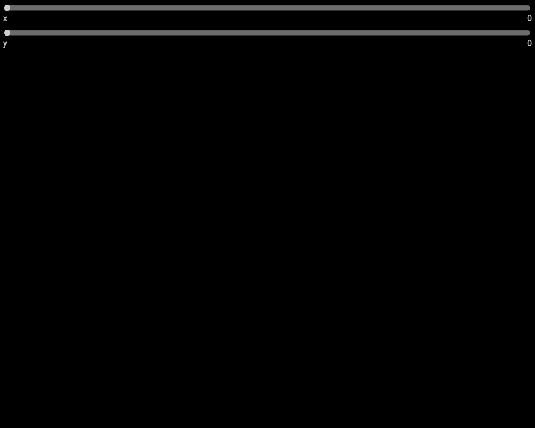

[source code](src/demo/kotlin/DemoWatchObjectDiv01.kt)

### DemoWidgets01

Demonstrates tabs, number fields, tooltips and context menus:

- the tabs at the top switch between pages
- number fields change by dragging them left and right, more finely with shift, or by typing: double-click a field or
press enter. The arrow keys change the focused field
- resting the pointer on a field shows its tooltip
- clicking a number field with the right button opens its context menu
- the text field selects by dragging, copies, cuts and pastes with the keyboard

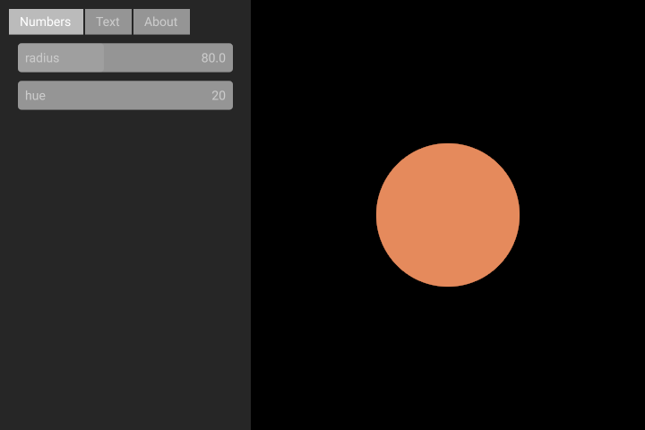

[source code](src/demo/kotlin/DemoWidgets01.kt)
