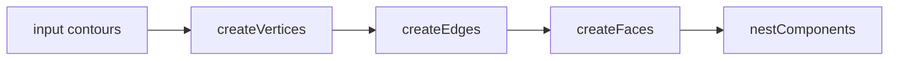

# Arrangement

`Arrangement` (in `Arrangement.kt`, package `org.openrndr.extra.shapes.arrangement`) computes the
*planar arrangement* of a list of shapes: it cuts every input contour at every point where it meets
another contour and builds a half-edge data structure (a DCEL) of the result. From that structure you
can read off

- **vertices**: the points where contours cross, touch or end,
- **edges**: the pieces of input contours between consecutive vertices,
- **faces**: the regions of the plane those edges enclose, each annotated with the input shapes that
  contain it.

```kotlin
val arrangement = Arrangement(circle, rectangle, line)
for (face in arrangement.originFaces) {
    drawer.shape(face.shape)
}
```

Inputs are `ShapeProvider`s (`Shape`, `ShapeContour`, `Circle`, `Rectangle`, ...). Open contours
are allowed; they add edges but never enclose a face on their own.

## Data model

| Type          | Meaning |
|---------------|---------|
| `XVertex`     | A point of the arrangement, with its `outgoing` and `incoming` half-edges. |
| `XEdge`       | A piece of one input contour between two vertices; `origin` is the shape it came from. Creating it also creates its two half-edges. |
| `XHalfEdge`   | One direction of an edge. Has a `twin` (the opposite direction), the `face` on its right and `next`, the following half-edge around that face. |
| `XFace`       | A face, identified by one of its half-edges (`edge`). Faces that are not `BoundedFace` are the *outer* faces of connected components. |
| `BoundedFace` | A face enclosing an area. `contour` is its outer boundary, `innerBoundaries` the outlines of components lying inside it, `shape` the face with those holes cut out. |

Convenience views on `Arrangement`:

- `vertices`, `edges`, `halfEdges`, `faces`
- `boundedFaces`, `unboundedFaces`
- `originFaces`: bounded faces that lie inside at least one input shape
- `holes`: bounded faces that lie inside no input shape (enclosed by edges of different shapes)
- `boundaries`: the outer boundary contour of each connected component
- `components`: one half-edge per connected component
- `cVertsMap`, `hEdgesMap`, `hFacesMap`: per-contour vertices, per-shape edges, per-shape faces

Every connected component contributes its own unbounded face, so for any arrangement
`V − E + F = 2C`, where `C` is the number of components (`unboundedFaces.size`), counting the
placeholder vertices of closed contours that touch nothing else (see below).

## Constructor parameters

```kotlin
data class Arrangement(
    val shapes: List<ShapeProvider>,
    val maxIters: Int = 1000,
    val epsilon: Double? = null,
)
```

- `maxIters`: the maximum number of edges around one face. If walking a face takes longer than this,
  construction throws instead of looping forever.
- `epsilon`: points closer together than this become one vertex. When `null`, `vertexEpsilon` is
  derived from the input: `1e-7 · diagonal + 2e-5`, where `diagonal` is the diagonal of the
  bounding box of all inputs. The `2e-5` floor matches the absolute tolerance of kartifex, which
  computes the raw intersections.

To include the self-intersections of a contour, pass its shape twice: `Arrangement(curve, curve)`.
Its contours are added only once, but are then intersected with themselves as well.

## How it is built

Construction runs three steps from `init`:



### 1. `createVertices`: find and merge intersection points

Work happens at the level of contour *segments*. Every point found on a contour is recorded as a
`ContourEvent(segment, t, node)`, where `node` is a candidate vertex in a union-find structure
(`nodePositions`/`nodeParents`, modelled on kartifex' `VertexUnion` in `utils/regions/Split.kt`).

1. **End points.** Each open contour gets a node at its start and one at its end.
2. **Sweep.** All segments are sorted by the left side of their bounding box (widened by ε). The
   sweep keeps a list of segments whose x-range still overlaps and tests each new segment against
   them with `intersections(Segment2D, Segment2D)`, which is kartifex' Bézier clipping. Segments of
   the same contour are only tested against each other if the shape was passed twice.
3. **One node per intersection.** Each intersection creates *one* node, which both segments
   reference. The two curves therefore agree on the vertex instead of each holding a slightly
   different copy.
4. **Newton refinement.** Kartifex' tolerances are in parameter space (≈1e-5 in `t`), so its
   points can be off by about `1e-5 · segment length`, and more near tangencies. `refineIntersection`
   takes up to 4 Newton steps on `A(s) − B(t) = 0`. A step is accepted only if it reduces the
   residual. It stops when the Jacobian is near singular (tangent curves) or a step would leave
   `[0, 1]`. Intersections that kartifex snapped exactly onto a segment end (`t = 0` or `1`) are not
   refined, so they still match exactly at the joints between segments.
5. **Canonical parameters.** `t = 1` on a segment is rewritten as `t = 0` on the next segment, and
   for closed contours the end of the last segment becomes the start of the first. Without this, the
   same point could be recorded under two different parameters.
6. **Merge along each contour.** Events are sorted by `(segment, t)`. Consecutive events, and the
   last and first events of a closed contour, that lie within ε of each other are joined. This is
   kartifex' `dedupe`.
7. **Merge nearby points.** Where three or more curves meet, every pair of curves finds its own,
   slightly different point, and those points share no curve pairwise. A kd-tree query joins all
   nodes within ε of each other.
8. **Vertices.** Each union-find root becomes one `XVertex`, placed at the mean of its members.

### 2. `createEdges`: cut contours into pieces

For each contour, the sorted events are paired (`zipWithNext`, plus last → first for closed
contours). `piece()` assembles the contour between two events directly from its segments: a partial
first segment, the whole segments in between, and a partial last segment, wrapping around on closed
contours. It then **snaps the piece's end points exactly onto the vertex positions**, so all edges
that meet at a vertex share bit-identical coordinates.

Special cases:

- A closed contour with no events (it touches nothing) becomes one edge from a placeholder vertex
  back to itself. The placeholder is not listed in `vertices`.
- A piece whose two events have the same parameter is empty and dropped. The exception is a closed
  contour with a single vertex, whose only piece is the whole loop.
- A piece that starts and ends at the same vertex is kept only if it is longer than 10·ε. It may be a
  genuine loop, such as a contour leaving a vertex and coming back to it.

### 3. `createFaces`: walk the faces

Faces are found by repeatedly following `next` from a half-edge that has not been visited yet, until
the walk returns to its start.

**`XHalfEdge.next`** picks the half-edge that continues the face at the target vertex: the one
that comes right before the twin in the angular order of the half-edges leaving that vertex.

That order is `XVertex.rotation`, computed once per vertex:

1. Sort the outgoing half-edges by the angle of their tangent at the vertex (`startAngle`).
2. Edges whose tangent angles lie within `1e-4` rad of each other (tangencies, such as a circle
   touching a square) are grouped, also across the −π/π wrap-around.
3. Within a group, order the edges by where each first crosses a small circle around the vertex
   (`probeAngle`, found by sampling and then bisection). Edges never cross each other, so the order in
   which they cross the circle is the true order around the vertex, and curves that leave in the same
   direction bend apart before they reach it. The radius is half the shortest "reach" of the edges in
   the group (`farthestDistance`).

Untied edges are ordered by tangent alone. The probe-circle work is only done for actual
tangencies.

Each completed walk is classified:

- If the walk traverses every one of its edges in both directions (for example around an open curve
  or a tree of open curves), it encloses nothing and is an unbounded `XFace`.
- Otherwise a clockwise walk is a `BoundedFace` and a counterclockwise walk is the outer face of a
  component.

`origins` (the input shapes containing a face) are determined by testing a point slightly inside the
face's first edge, at `faceProbeOffset = max(1e-5 · diagonal, 2ε)` from it, against each closed input
shape.

### 4. `nestComponents`: holes for nested components

Separate connected components can lie inside one another. The face of the outer component then
covers the inner one. Without correction its `contour` overlaps the inner component's faces, and
drawing faces in arbitrary order paints over them.

`nestComponents` labels components by flood fill over the half-edges. Then, for the outer face of
each component, it finds the smallest bounded face of *another* component that contains one of its
vertices. Faces of different components never touch, so any faces containing a point are nested and
the innermost has the smallest bounding box. That face becomes the component's `parent`, and the
component's outer boundary is added to the face's `innerBoundaries`. `BoundedFace.shape` combines
the two.

**Draw `face.shape`, not `face.contour`,** when components can be nested.

## Recent changes

The vertex and edge construction was rewritten for precision. Before, it worked like this:

- intersections were computed for each pair of shapes with `ShapeContour.intersections`,
- the results were merged with a kd-tree at a fixed radius of `0.1`, placing each vertex at the
  average of its cluster,
- parameters were deduplicated in normalized `contourT` space (within `1e-2`),
- edges were cut with `ShapeContour.sub(t0, t1)`.

That had several consequences:

- The fixed radius is about 10,000× coarser than kartifex' tolerance, so genuinely distinct points
  closer than 0.1 were merged. A triangle with 0.05 sides collapsed into a single vertex.
- At small scales everything collapsed. A scene scaled by 0.002 failed with an
  `IndexOutOfBoundsException`.
- `contourT` is `(segmentIndex + t) / segmentCount`, so `1e-2` could span a whole segment on long
  contours.
- Edge ends did not coincide exactly with their vertex. The angle test in `next` therefore needed a
  probe-circle fallback that sometimes guessed.

### What changed

| Area | Before | After |
|------|--------|-------|
| Intersection search | each contour pair, all segments against all segments | x-sweep over segments |
| Vertex identity | separate point per pair, merged by kd-tree radius 0.1 | one shared union-find node per intersection |
| Merge tolerance | fixed 0.1 | `1e-7 · diagonal + 2e-5`, overridable with `epsilon` |
| Dedupe | `contourT` within 1e-2 | per contour, by distance ε after sorting by `(segment, t)` |
| Point accuracy | kartifex result as is | Newton-refined (residuals ≈1e-13 instead of up to ≈1e-5) |
| Edge geometry | `contour.sub(t0, t1)` | assembled from segments, ends snapped exactly onto vertices |
| `next` | tangent angles in [0, π], probe-circle guess on ties, twin as fallback | rotational order per vertex (tangent angle; probe circle for tangencies), the edge before the twin |
| Faces of open curves | bounded or unbounded depending on round-off | always unbounded |
| Containment probe | fixed offset 0.01 | `max(1e-5 · diagonal, 2ε)` |
| Nested components | outer face covers inner components | `innerBoundaries` holes, `BoundedFace.shape`, `XFace.parent` |
| Contours in one shape | not intersected with each other | intersected with each other |
| Face walk bookkeeping | `removeAll`/set lookups through data-class `equals` (compares whole contours) | identity comparisons and a per-half-edge walk index |
| Input shapes | `ShapeProvider.shape` re-evaluated per face and per shape | computed once (`inputShapes`), so inside tests reuse their cached region |

### API additions

- `Arrangement.epsilon` (constructor parameter, default `null`) and `Arrangement.vertexEpsilon`
- `BoundedFace.innerBoundaries` and `BoundedFace.shape`
- `XFace.parent`

Existing properties keep their meaning, with one difference: `BoundedFace.contour` is now explicitly
only the outer boundary of a face.

### Origin of the approach

The design came out of comparing `Arrangement` with openrndr-kartifex, the library behind
openrndr's boolean operations.

Taken over from kartifex:

- union-find vertex identity (`VertexUnion`),
- per-curve dedupe (`dedupe`),
- snapping split pieces onto the vertex representatives (`split(ring, …)`),
- the sweep (`SweepQueue`).

Deliberately not taken over: kartifex' graph-based region assembly (`DirectedGraph` and
`Graphs.cycles` in `Clip.kt`). It lists every simple cycle and picks cycles greedily by area. That
suits boolean-operation output but does not list the faces of an arrangement, and the number of
cycles can grow exponentially on dense inputs. The angle-ordered half-edge walk is kept instead.

## Known limitations

- **Self-intersections** are only found when a shape is passed twice. A single cubic segment that
  loops onto itself is not split. openrndr's segment-against-segment intersection skips a segment
  tested against itself.
- **Overlapping curves** (collinear lines, coincident arcs) are not handled. Kartifex reports at most
  a few points along a shared stretch, not the overlap itself.
- **Tangencies** are found by kartifex with limited reliability: a touching point may come back as
  0, 1 or 2 points. Duplicates are merged, and the Newton refinement skips tangent points. A missed
  touch leaves the two curves unconnected there.
- **Very small inputs.** Kartifex' absolute 1e-5 tolerance sets a floor: for inputs only a few units
  across, features smaller than about 1e-4 are not resolved reliably. Kartifex tolerances that scale
  with segment length or bounding box would lift this. That change would be in openrndr, not here.
- **Face orientation** relies on openrndr's winding convention: bounded faces walk clockwise.
- The public maps (`cVertsMap`, `hEdgesMap`, `hFacesMap`, `faces`) are mutable. Treat them as
  read-only.
