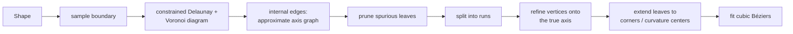

# Medial axis

`Shape.medialAxis()` (in `MedialAxis.kt`, package `org.openrndr.extra.shapes.medialaxis`) computes
the medial axis of a closed shape and returns it as a graph of smooth branches between nodes.

```kotlin
val axis = shape.medialAxis(samplingDistance = 2.0)
drawer.contours(axis.contours)          // one ShapeContour per branch
drawer.circles(axis.nodes, 3.0)         // leaves and junctions
val r = axis.radius(axis.nodes[0])      // radius of the inscribed disk at a point
```

## What the medial axis is

The medial axis of a shape is the set of centers of all *maximal inscribed disks*: disks that fit
inside the shape and are not contained in any larger disk that also fits. Equivalently, it is the
set of interior points that have two or more nearest points on the boundary.

- **Branches** are the runs where the disk touches the boundary in two places.
- **Junctions** are points where it touches three or more places.
- **Leaves** are where a branch ends:
  - at a **convex corner**, where the disk shrinks to radius 0,
  - at a **center of curvature** of a smooth boundary, where the two touching points merge. For
    example, the axis of an ellipse with semi-axes a > b ends at x = ±(a − b²/a).

Together with the radius at each point, it describes the shape completely. That makes it useful for
skeletons, stroke-like rendering, thickness analysis and shape matching.

## Data model

| Type | Meaning |
|------|---------|
| `MedialAxis` | `shape` (the input), `nodes: List<Vector2>`, `branches: List<MedialAxisBranch>`, `contours` (the branch contours), `radius(point)` |
| `MedialAxisBranch` | `contour` (a cubic Bézier `ShapeContour`), `start`, `end`: indices into `nodes`, or −1 for an isolated loop (closed contour) |

Branches that meet at a node share its position exactly. An annulus gives a single closed branch with
no nodes.

`radius(point)` is the distance from `point` to the nearest boundary contour. On the axis that is the
radius of the maximal inscribed disk.

## Parameters

```kotlin
fun Shape.medialAxis(
    samplingDistance: Double = 2.0,
    fitTolerance: Double = samplingDistance * 0.1,
    pruneLength: Double = samplingDistance * 2.0,
): MedialAxis
```

- `samplingDistance`: the spacing of the boundary samples. Smaller values capture finer detail and
  cost more. Features narrower than a few samples are not resolved.
- `fitTolerance`: the maximum distance between the refined axis points and the fitted Bézier branches.
- `pruneLength`: leaf branches attached to a junction whose *significance* is below this are removed
  (see [Pruning](#3-pruning)).

There is also a lower-level entry point, `medialAxis(shape, diagram, fitTolerance, pruneLength)`.
It takes a `ConstrainedVoronoiDiagram` you built yourself, as long as its sites lie on the boundary
of `shape`.

## Pipeline



The idea: the Voronoi diagram of points sampled densely along a boundary converges to the medial
axis, plus short spurious "spikes" between neighbouring samples. The Voronoi diagram therefore gives
the **topology** cheaply. The **geometry** is then corrected against the original curved boundary,
so the result is much more accurate than the sampling alone.

### 1. Sampling (`Shape.medialAxis`)

- Only closed, non-empty contours are used.
- Each contour is flattened with `sampleLinear(samplingDistance · 0.25)`, which keeps corners. Every
  linear piece is then subdivided so that samples are at most `samplingDistance` apart.
- Coinciding consecutive points (within 1e-9) are dropped, and contours with fewer than 3 points are
  discarded.

The flattening can be coarse because the later refinement works on the *original* curves, not on
the polygon.

### 2. Voronoi diagram (orx-triangulation)

- The sampled polygon goes into `constrainedDelaunayTriangulation()`, and from there into
  `voronoiDiagram(bounds)`, with the bounds padded by 10% + 1.
- `ConstrainedVoronoiDiagram.internalEdges()` computes the internal edges of the *unconstrained*
  Voronoi diagram of the sample points, i.e. the edges between circumcenters of adjacent Delaunay
  triangles. Circumcenters that coincide are merged.
- It keeps only edges whose end points lie inside the shape, away from its contours, and that cross
  no contour segment.

The result is a list of vertices plus index-pair edges: the approximate medial axis graph.

### 3. Pruning

The raw graph has a short spike towards almost every boundary sample. These are removed in
`Graph.prune` using the *significance* of a leaf run (from a junction to a leaf):

```
significance = length − (radius at junction − radius at leaf)
```

The radius at a vertex is estimated as its distance to the nearest sample site (kd-tree). A spike
runs straight towards the boundary, so its radius drops exactly as fast as its length grows, and its
significance is about 0. A genuine branch keeps a roughly constant radius, so its significance is
about its length.

Runs below `pruneLength` are removed, least significant first. A removal is never allowed to turn a
junction into a leaf. This repeats until nothing changes.

### 4. Runs (`Graph.branches`)

The pruned graph is split into maximal runs whose interior vertices have degree 2. They run between
leaves (degree 1) and junctions (degree ≥ 3). What remains afterwards are cycles of degree-2
vertices, which become closed runs (for example the axis of an annulus).

### 5. Refinement onto the true axis (`Refiner`, `Boundary`)

Each run vertex `v` is moved onto the medial axis of the *original* shape:

1. **Seeds.** Take the 8 nearest sample sites to `v`, and project each onto the original boundary
   (`Boundary.project`, the nearest point over all segments, pruned by bounding-box distance).
   Projections more than one sample spacing away from their site are ignored.
2. **Feet.** From each seed, `Boundary.localFoot` runs Newton iteration on the squared distance
   along the contour to find the *local* nearest boundary point ("foot") to `v`. It crosses into
   neighbouring segments where the distance keeps decreasing, and stops at concave corners. Feet
   within 1e-6 · scale of each other are merged, which leaves the distinct boundary pieces `v` is
   (nearly) equidistant to.
3. **Solve for equal distance.**
   - For **junctions** (degree ≥ 3, with 3 distinct feet), solve `d₀ = d₁ = d₂` with Newton steps on
     the 2×2 system built from the unit vectors towards the feet.
   - **Otherwise** use the two nearest feet: step along the gradient of `d₀ − d₁` until they are
     equal.
   - After each step the feet are re-solved locally. Steps are limited to
     `max(spacing, ¼ · nearest distance)`. The iteration stops when the step falls below
     1e-10 · scale (max. 32 iterations).
4. **Accept or keep.** The refined point is used only if it moved at most `max(½ · r₀, 2 · spacing)`
   and lies inside the shape. Otherwise the original Voronoi vertex is kept.
5. **Classify** the vertex:
   - `corner`: the two feet are on adjacent segments meeting at an angle (> 1e-3 rad), so this part
     of the axis points at a convex corner.
   - `twoSided`: the feet are at least one spacing apart, and the boundary between them bulges at
     least 0.1 · spacing away from the inscribed disk (`Boundary.gap`). The disk really touches the
     boundary in two separate places.
   - `tip`: for two-sided vertices not at a corner, the center of curvature at the point of maximum
     curvature on the boundary arc between the feet (`maximumCurvatureCenter`). It must lie on the
     disk's side, inside the shape, and within half the radius of the vertex. This is where the axis
     would end if continued.

Refined vertices are cached per graph vertex, so junctions shared by several runs are refined once.

### 6. Leaf ends

For each open run:

- **Trim:** leaf-end vertices that are neither `corner` nor `twoSided` are trimmed. They are
  remnants of pruned spikes.
- **Extend:** the leaf is then extended to its `corner` if it has one. Otherwise it is extended to
  its `tip`, but only if the tip lies within 30° of the direction in which the branch arrives,
  measured over about one inscribed radius (`branchDirection`). A tip that doesn't continue the
  branch belongs to a pruned fork, as seen at flattened ends that have two curvature maxima.
- **Nodes:** run end points become `nodes`, deduplicated per graph vertex. Branches meeting at a
  junction therefore get the same node index and position.

### 7. Fitting

- `removeBacktracks` drops interior points that coincide with their predecessor or make the
  polyline fold back on itself. End points are kept.
- `fitCubicBeziers` (orx-shapes `fit/Fit.kt`) fits the polyline within `fitTolerance`. The fit keeps
  the end points, so node positions stay exact.
- A degenerate run of one point becomes a zero-length segment.

## Accuracy

Tests (`commonTest/kotlin/TestMedialAxis.kt`):

- **Rectangle 200 × 100:**
  - 5 branches and 6 nodes: two junctions joined by a straight branch, plus four branches to the
    corners.
  - Nodes lie on the corners within 1e-6 and on the junctions (50, 50) and (150, 50) within 1e-3.
  - Every axis point is equidistant to its two nearest sides within 1e-2.
- **Ellipse 100 × 50:** one branch on the major axis (|y| < 0.05), ending at x = ±75 within 0.5,
  the centers of curvature of the vertices.
- **Annulus 100 / 50:** one closed branch at radius 75 within 0.05. The circles are Bézier
  approximations, so their true axis deviates slightly from 75.

`DemoMedialAxis01` draws the axes of a rectangle, an ellipse, an off-center annulus and a 9-pointed
Hobby-curve star. It draws inscribed disks along each branch, at 10-unit intervals.

## Known limitations

- **Open contours are ignored.** Only closed contours take part.
- **Sampling sets the resolution.**
  - Features narrower than a few `samplingDistance` (thin necks, small notches) may be lost or
    misrepresented in topology.
  - `pruneLength` also removes genuine short branches below the threshold.
- **Concave corners** produce no branch, which is correct, but the vertices near them refine
  against a corner point rather than a smooth piece. Convergence there relies on the step limits.
- **Refinement can fail quietly.** When a vertex can't be moved onto the axis within its limits, it
  keeps its Voronoi position. The result is then only as accurate as the sampling there.
- **Performance:**
  - `ConstrainedVoronoiDiagram.internalEdges` checks every candidate edge against every boundary
    segment.
  - `Boundary.project` sorts all segments by bounding-box distance on every call.
  - Both scale quadratically with the number of samples. For large shapes a spatial index would
    help.
- `radius(point)` takes the nearest point over all contours. Away from the axis it is simply the
  distance to the boundary, not an inscribed-disk radius.
