# orx-svg

SVG reader and writer library.

## Methods

```kotlin
fun loadSVG(fileOrUrlOrSvg: String): Composition
fun loadSVG(file: File): Composition

fun parseSVG(svgString: String): Composition

fun Shape.toSvg(): String
fun ShapeContour.toSvg(): String

fun Composition.saveToFile(file: File)
fun Composition.toSVG(): String
```

Find basic examples of loading and saving SVG files 
[in the guide](https://guide.openrndr.org/drawing/drawingSVG.html).

_The code in `orx-svg` was previously found under `openrndr-svg` in the `openrndr` repository._
<!-- __demos__ -->
## Demos
### DemoSvg01

Demonstrates loading an SVG document with `loadSVG` and drawing it with `drawer.composition`.

The document has basic shapes, paths with curves and arcs, a path with a hole (fill-rule evenodd) and nested
groups with transforms. Loading it gives a composition: a tree of groups and shapes with their styles. Hover over
a shape to outline it: the shapes of a composition can be found and used as regular OPENRNDR shapes.

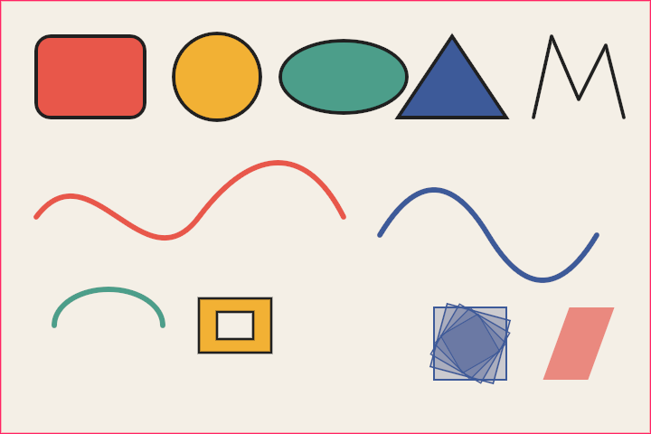

[source code](src/jvmDemo/kotlin/DemoSvg01.kt)

### DemoSvg02

Demonstrates SVG gradients, which are loaded as gradient paints and drawn with shade styles:

- the top row shows the spread methods pad, reflect and repeat, with gradients that inherit their stops from
another gradient with `xlink:href`
- the middle row shows radial gradients: one with a focal point, one with transparent stops and one with a focal
radius and the reflect spread method
- the bottom row shows a gradient in user space shared by a rectangle and a circle, so it continues across them,
a rotated gradient and a gradient stroke

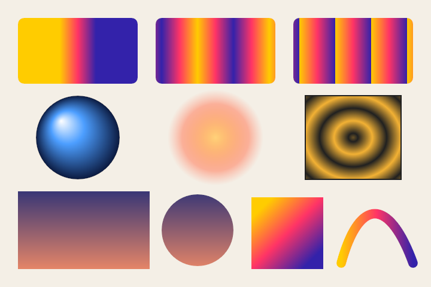

[source code](src/jvmDemo/kotlin/DemoSvg02.kt)

### DemoSvg03

Demonstrates SVG text: text with tspans that change the color, size and position of runs, text anchors, gradient
fills over the bounds of a text and text along a path with a gradient fill and stroke.

The fonts of text are resolved by family with `CompositionFonts`; text in families that are not registered is
drawn with the default font.

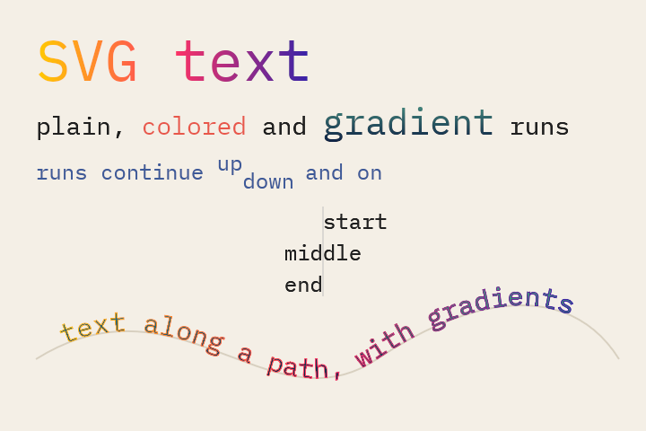

[source code](src/jvmDemo/kotlin/DemoSvg03.kt)

### DemoSvg04

Demonstrates changing the paints of a loaded SVG document. The shapes of the group with the id "basics" are filled
with presets instead of their colors: a gradient that turns, noise that moves, checkers and a kaleidoscope-like
gradient. Presets are objects with properties; changing them every frame does not compile new shaders.

The strokes of the paths in the group "paths" get a gradient in user space that slides along.

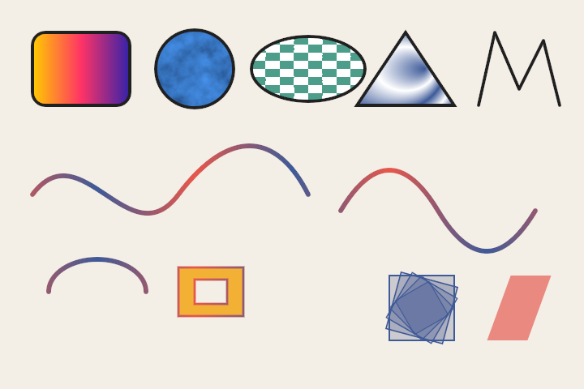

[source code](src/jvmDemo/kotlin/DemoSvg04.kt)

### DemoSvg05

Demonstrates writing a loaded SVG document back to SVG: the composition is written with `toSVG`, including the
gradients it uses, and the result is parsed again. The original is drawn on the left, the document that was
written and read back on the right; they look the same.

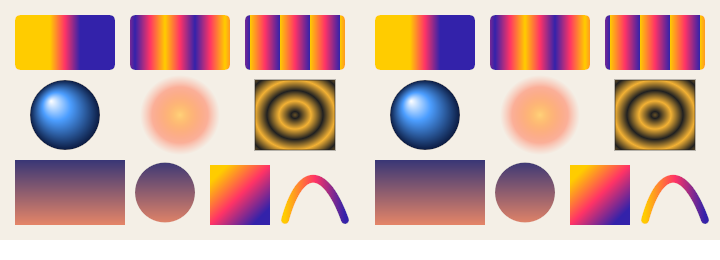

[source code](src/jvmDemo/kotlin/DemoSvg05.kt)

### DemoSvg06

Demonstrates fill rules, which decide which parts of shapes with overlapping or self-intersecting contours are
filled. The same three paths are drawn with fill-rule="nonzero" (the default of SVG) on top and
fill-rule="evenodd" at the bottom:

- a pentagram, of which the center is surrounded twice: filled under nonzero, empty under evenodd
- a square with a hole that turns the same way as the outline: filled under nonzero, a hole under evenodd
- a square with a hole that turns the other way: a hole under both rules

The fill rule is set on the groups and inherited by the paths in them. Press space to swap the rules of the
groups.

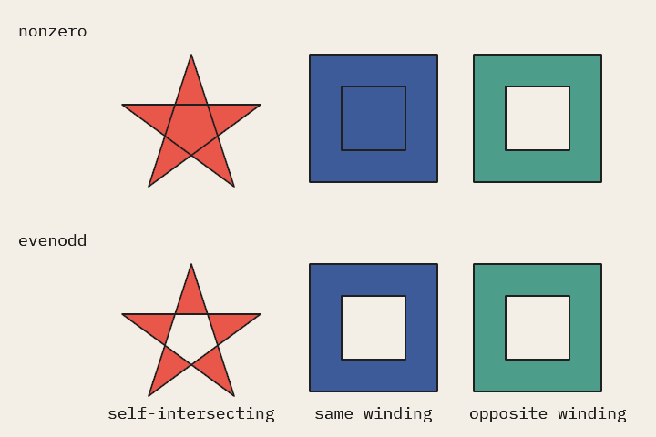

[source code](src/jvmDemo/kotlin/DemoSvg06.kt)

### DemoSvg07

Demonstrates SVG patterns: content that is drawn in a tile which repeats.

- top row: a checkerboard in user space that continues across a rectangle and a circle, and four by four tiles
over the bounds of an ellipse
- middle row: content in bounds units, a view box fitted into the tile and stripes turned by a pattern transform
- bottom row: a pattern with gradients in it, a pattern that inherits its content and is scaled, and a pattern
stroke

The tiles are drawn to textures at the scale they are shown at. Press space to zoom in and out: the tiles are drawn
again when the scale changes enough, so they stay sharp.

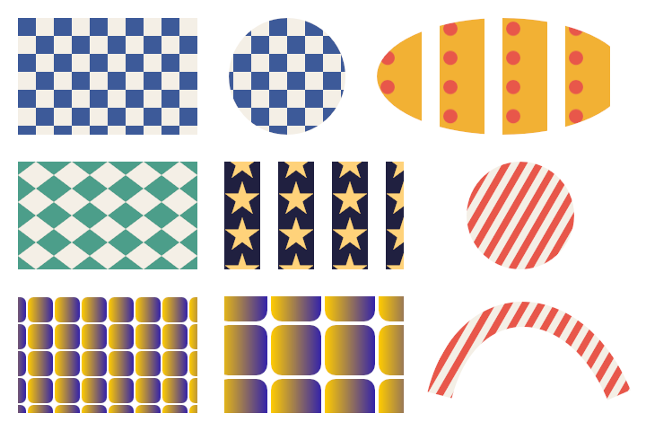

[source code](src/jvmDemo/kotlin/DemoSvg07.kt)

### DemoSvg08

Demonstrates SVG patterns on text: a checkerboard in user space, stripes turned by a pattern transform, as a fill
and as a stroke, dots in a pattern over the bounds of a text, and text along a path with a pattern fill.

A pattern in user space continues through all glyphs of a text; a pattern over the bounds of a text spans the whole
text element, so the dots of "dots in bounds" are laid out over the full width of the line.

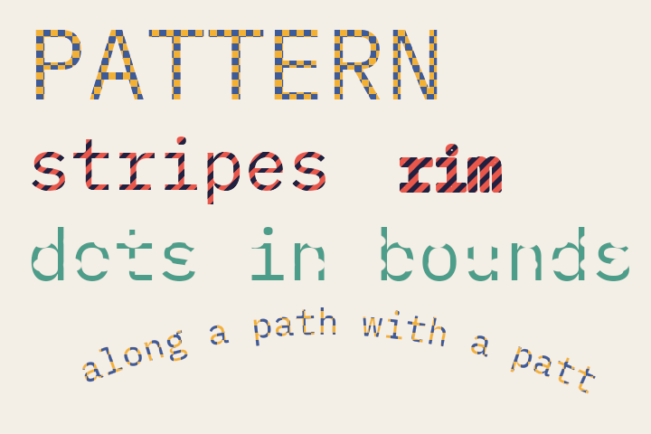

[source code](src/jvmDemo/kotlin/DemoSvg08.kt)

### DemoSvg09

Demonstrates SVG features that documents exported by design tools use:

- top left: a style element with CSS rules for classes, types, ids and descendants; a style attribute overrides
them, as do more specific rules
- top right: display="none" and visibility="hidden" (a visible child of a hidden group is drawn), colors in #rgba,
#rrggbbaa, rgba(), hsl() and hsla() notation, and currentColor, which takes the color property of a group
- middle: use elements that draw copies of a circle and of a symbol, which is fitted into the size of the use
element by its view box, and a switch element, of which only the first child is drawn
- bottom: in a group that is scaled 4 by 2, a regular stroke scales with it, a non-scaling stroke
(vector-effect="non-scaling-stroke") does not

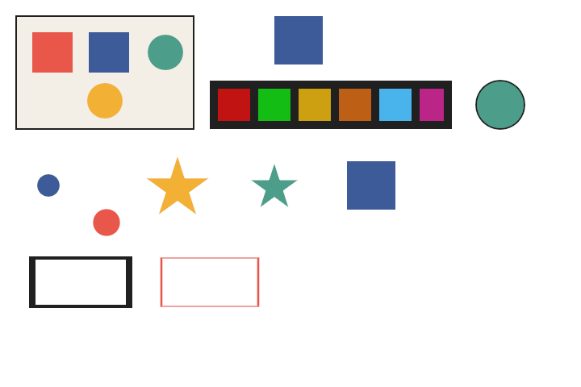

[source code](src/jvmDemo/kotlin/DemoSvg09.kt)

### DemoSvg10

Demonstrates dashed strokes (stroke-dasharray and stroke-dashoffset): dashes and gaps, a pattern with an odd number
of lengths, which repeats, an offset, dots made by dashes of length zero with round caps, dashes around closed shapes
and along curves, and a dashed stroke with a gradient.

The dash offsets of all dashed shapes are animated, which makes the dashes march along the shapes.

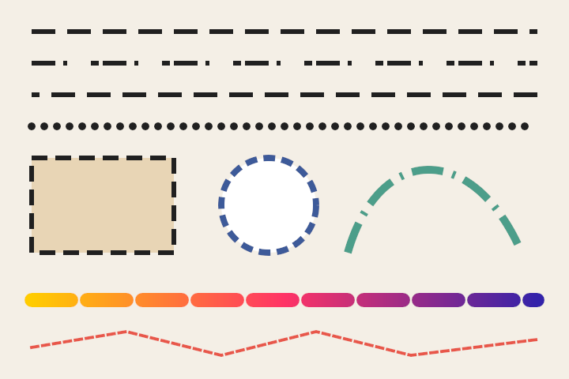

[source code](src/jvmDemo/kotlin/DemoSvg10.kt)

### DemoSvg11

Demonstrates clip paths and paint order:

- a group clipped by a circle: the fills and strokes in it are clipped, with anti-aliased edges
- a clip path over the bounds of a shape, and a clip path with clip-rule="evenodd"
- nested clip paths: a band within a rectangle, clipping shapes and text; the band turns, clip paths are applied
every frame
- paint-order="stroke": the stroke of the text and of the circle in the band is painted under the fill, the circle
at the top right has the normal paint order

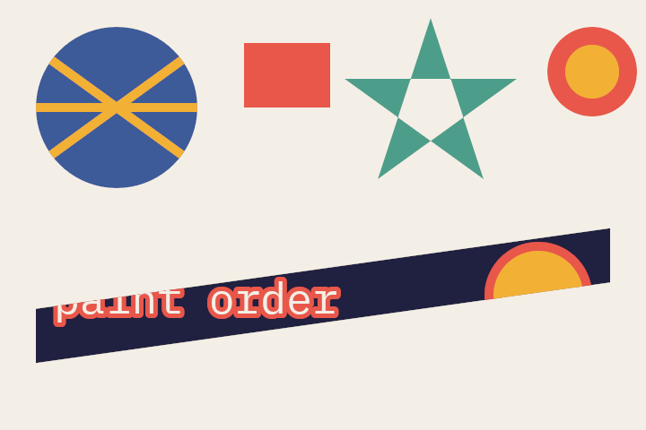

[source code](src/jvmDemo/kotlin/DemoSvg11.kt)

### DemoSvg12

Demonstrates markers, drawn at the vertices of paths:

- arrowheads sized in stroke widths, with orient="auto-start-reverse" so the arrow at the start points backwards
- dots in user space units, set with the CSS `marker` shorthand in a style sheet
- ticks that are turned along the bisectors of a polygon's corners, and diamonds at a fixed angle
- markers whose content overflows their viewport and is clipped, on a path with smooth quadratic segments

The zigzag and the curve are changed every frame; their markers follow the vertices and directions.

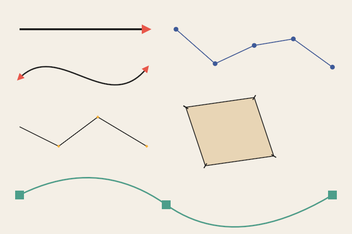

[source code](src/jvmDemo/kotlin/DemoSvg12.kt)

### DemoSvg13

Demonstrates nested svg elements, units, color interpolation and CSS transforms:

- top left: a nested svg whose view box is fitted to its viewport with preserveAspectRatio="xMidYMid slice" and
clipped, next to one with overflow="visible"
- middle: lengths in percentages of the viewport, in em of the font size, and in mm, in and pt
- bottom left: a gradient interpolated in sRGB, and the same gradient with color-interpolation="linearRGB"
- right: transforms with CSS units and functions, in style attributes and a style sheet, around a transform-origin

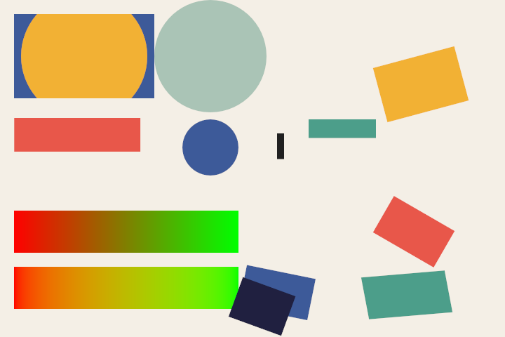

[source code](src/jvmDemo/kotlin/DemoSvg13.kt)

### DemoSvg14

Demonstrates text properties and CSS:

- letter-spacing and word-spacing; the letter spacing of the first line changes over time
- text placed on its dominant baseline, and text shifted to superscripts and subscripts by baseline-shift
- x, y, dx, dy and rotate given for every character; the rotation of "TURNING" changes over time
- underlines, overlines and lines through text
- custom properties used with var(), with fallbacks and in presentation attributes, lengths computed with calc(),
and an !important declaration that wins from the style attribute
- a path with a pathLength of 10, its dashes and the start offset of the text along it are in units of that length,
and a circle drawn without anti-aliasing with shape-rendering="crispEdges"

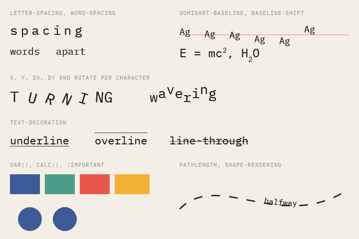

[source code](src/jvmDemo/kotlin/DemoSvg14.kt)

### DemoSvg15

Demonstrates group opacity, masks and blend modes, which draw nodes on layers of their own:

- a group with an opacity is drawn before its opacity is applied, the overlap of its circles does not show, unlike
that of the circles below it, which have an opacity of their own
- a luminance mask: a soft spot that moves over a group of text
- alpha masks in the bounds of a rectangle and of a text
- the sixteen blend modes of CSS: a circle blended with a gradient
- a disc blended with mix-blend-mode: difference, moving over everything

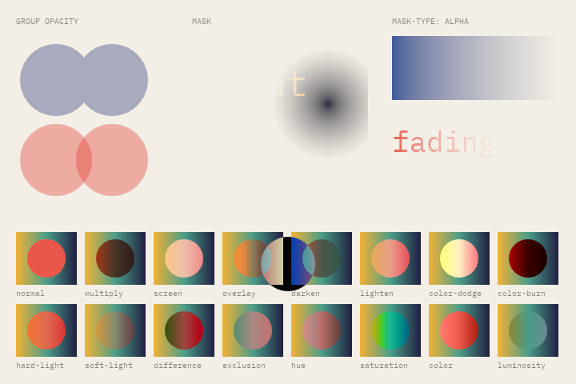

[source code](src/jvmDemo/kotlin/DemoSvg15.kt)

### DemoSvg16

Demonstrates SVG filters and the filter functions of CSS, applied on layers:

- a Gaussian blur, its standard deviation changes over time
- a drop shadow, its offset turns around the card
- a halo of a text: its alpha dilated, blurred, colored and merged under the text
- colors rotated around the hue circle
- fractal noise colored by a color matrix, and turbulence displacing a text; the displacement changes over time
- posterized colors, a duotone made by blending, and the sepia, contrast, invert, blur and drop-shadow functions

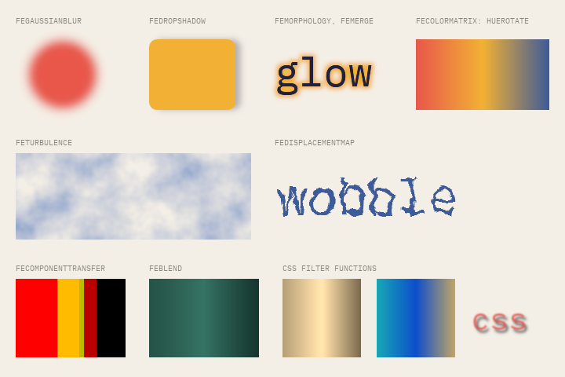

[source code](src/jvmDemo/kotlin/DemoSvg16.kt)

### DemoSvg17

Demonstrates text layout and the color functions of CSS:

- SVG 2 text that wraps at its inline-size, with a line-height; the inline size changes over time
- text adjusted to its textLength by the space between its characters, and by stretching its glyphs; the length
changes over time
- white-space: pre, spaces are kept
- oklch() hues, color-mix() in oklch and in sRGB, and lab(), hwb(), color(display-p3 ...) and lch() with alpha

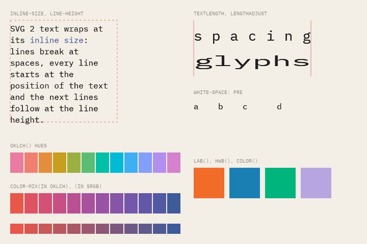

[source code](src/jvmDemo/kotlin/DemoSvg17.kt)

### DemoSvg18

Demonstrates image elements that refer to other SVG documents: the documents are loaded as compositions of their
own, fitted into the viewport of the image following preserveAspectRatio, clipped to it, and isolated from the
styles of the document that refers to them. A document in a data url is loaded too.

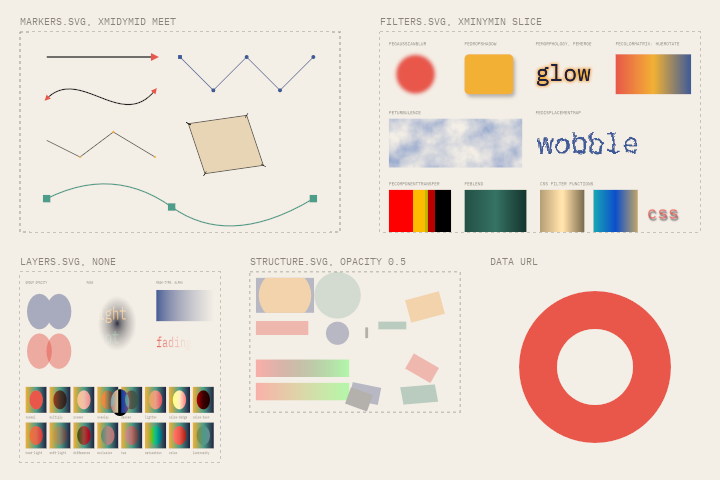

[source code](src/jvmDemo/kotlin/DemoSvg18.kt)

### DemoSvg19

Demonstrates references to other documents:

- use elements that refer to symbols in a sprite sheet, sprites.svg; the first symbol turns
- image elements that show views of the sprite sheet, by the ids of view elements and by svgView()
- feImage drawing the sprite sheet into a filter, and an element of the document repeated by feImage and feTile
- a checkerboard of flooded subregions repeated by feTile
- a style sheet imported with @import

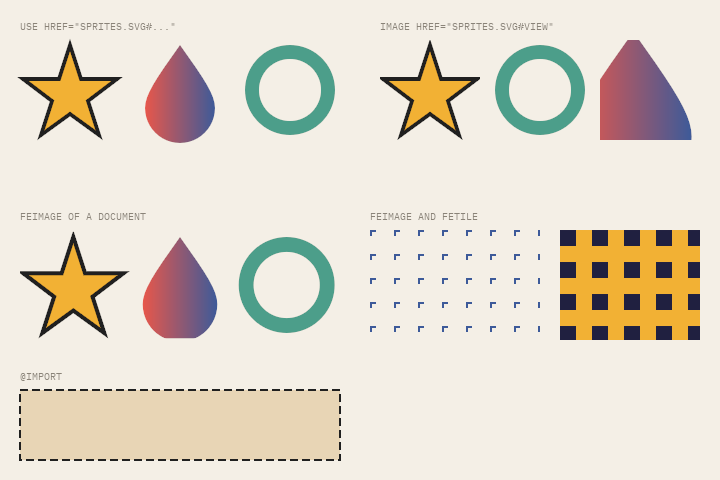

[source code](src/jvmDemo/kotlin/DemoSvg19.kt)

### DemoSvg20

Demonstrates interaction with a composition, and text along paths and in vertical lines:

- shapes are hit like in SVG: on their fill, with its fill rule, and on their stroke; the shape under the mouse is
outlined, clicking a shape shows its id, clicking the link shows where it leads
- text on the right side of a path, and along a path given in the path attribute of textPath
- vertical text, turned sideways and upright

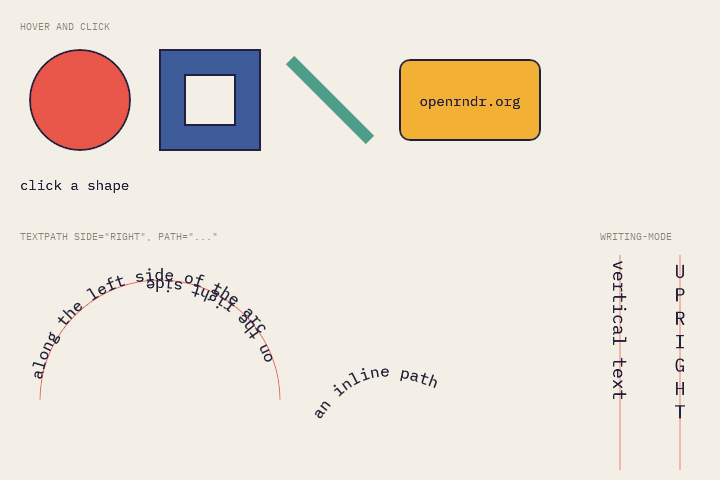

[source code](src/jvmDemo/kotlin/DemoSvg20.kt)

### DemoSvg21

Demonstrates the direction of text and more of vertical text:

- right to left text: its start is on the right, text-anchor end on the left, tspans follow each other to the
left, bidi-override reverses the characters
- text-decoration of vertical text: the underline on the left of the line, the overline on the right
- vertical text along a path, centered on it
- vertical text that wraps into columns at its inline size, which changes over time

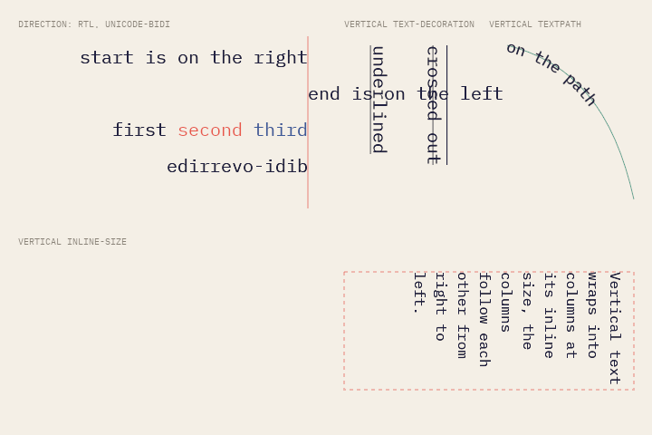

[source code](src/jvmDemo/kotlin/DemoSvg21.kt)

### DemoSvg22

Demonstrates animated SVG documents, driven by the time of the program and the mouse:

- SMIL animation: a spinner turned by animateTransform, an arrow moving back and forth along a path with
animateMotion, colors and rounded corners animated with animate
- a CSS animation with @keyframes
- buttons with :hover and :active rules, and transitions between their states
- animations that begin when the blue circle is clicked, one of them half a second later

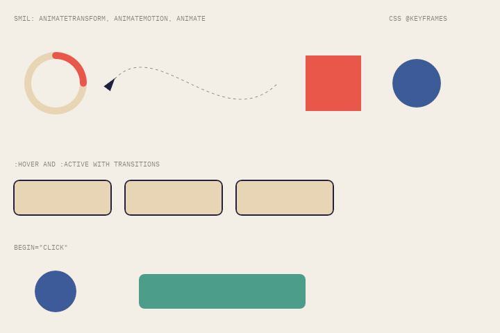

[source code](src/jvmDemo/kotlin/DemoSvg22.kt)

### DemoSvg23

Demonstrates transitions started by the program changing styles:

- clicking a tile toggles its class `on`, the rule for `.tile.on` changes its fill, transform and stroke width
- pressing a key toggles the class `alt` of the rows, a descendant rule changes the fill of all their tiles
- every second `setProperty` sets the dash array of some tiles, like an inline style; the transitions in the style
sheet do not cover it, so it changes at once
- pressing the space bar sets the stroke weight of the nodes directly, it is transitioned like the class changes

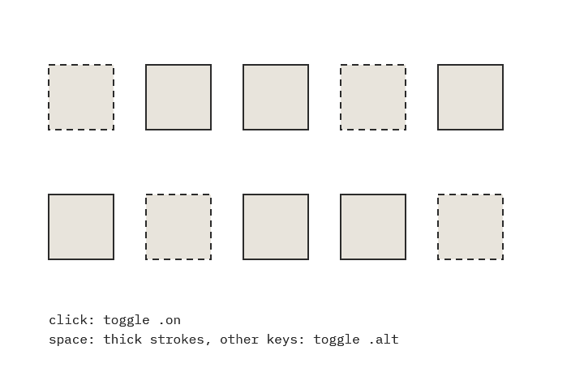

[source code](src/jvmDemo/kotlin/DemoSvg23.kt)

### DemoSvg24

Demonstrates line joins and markers painted with the paints of the paths that use them:

- the joins of SVG 2: miter, miter-clip, arcs, bevel and round, with a miter limit of 2.5. The corners become
sharper and blunter over time; past the miter limit a miter is beveled, a clipped miter is cut off at the limit.
Arcs joins are drawn as clipped miters, which is what they are between straight segments.
- markers painted with context-fill and context-stroke: arrowheads in the color of the stroke of their line, or
filled with its fill and outlined with its stroke; rings in the colors of their polyline, hollow on the polyline
that has no fill

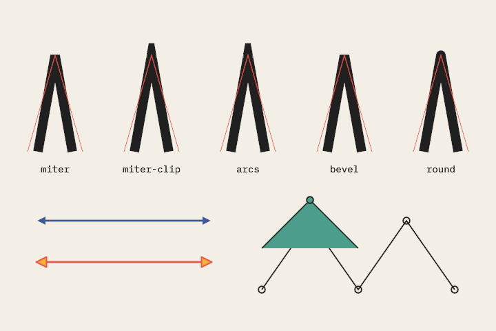

[source code](src/jvmDemo/kotlin/DemoSvg24.kt)

### DemoSvg25

Demonstrates CSS motion paths, individual transforms, the d property, and the events and playback control of
animations:

- a car and a follower driven along a track with offset-path and an animated offset-distance; the car turns with
the track, the follower keeps upright with offset-rotate: 0deg
- boxes animated with the rotate, scale and translate properties, which combine with their transforms
- a star that morphs into a decagon with @keyframes of d: path(...); clicking it toggles a class that stops the
morph and transitions d to the decagon
- clicking the car begins a SMIL animation with beginElement, a second animation begins with its begin event
- space pauses and plays, the left and right arrows seek, the up and down arrows change the playback rate; the
events of the animations are listed

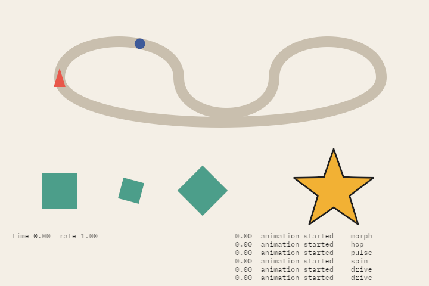

[source code](src/jvmDemo/kotlin/DemoSvg25.kt)
