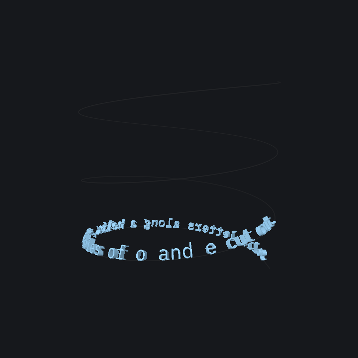
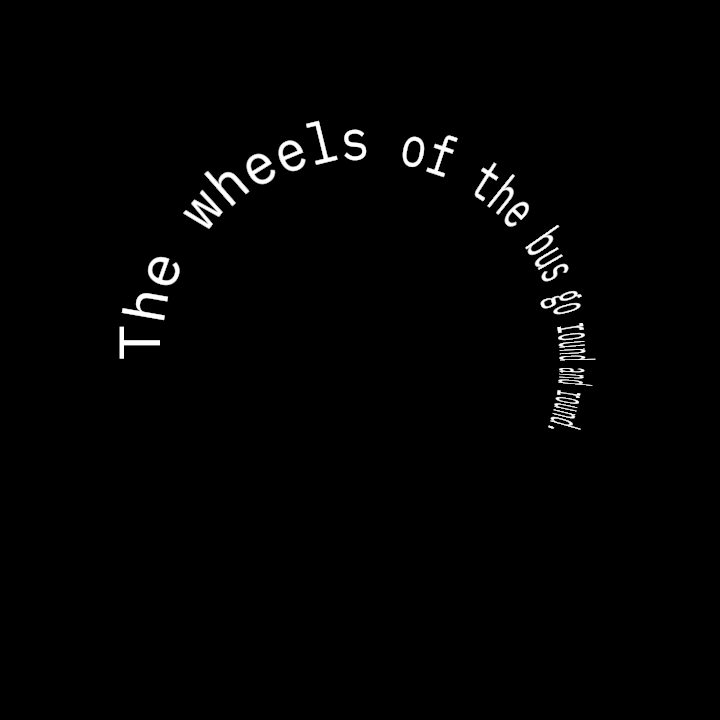
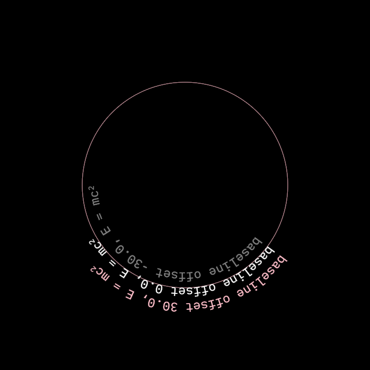
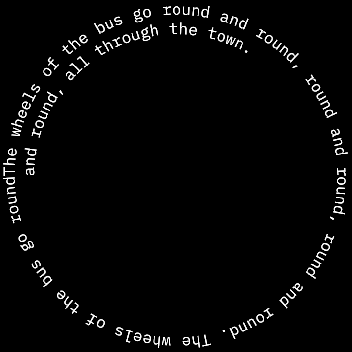
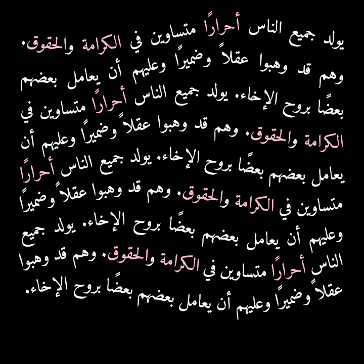
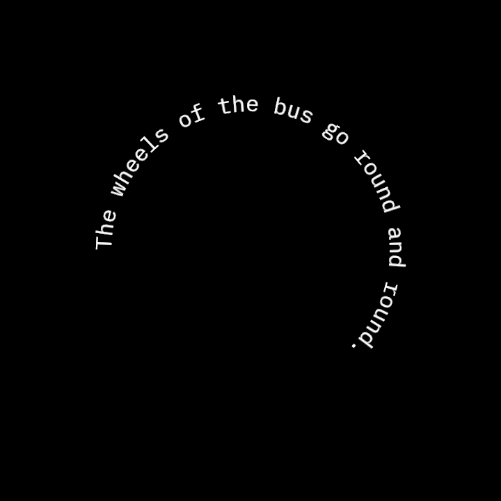
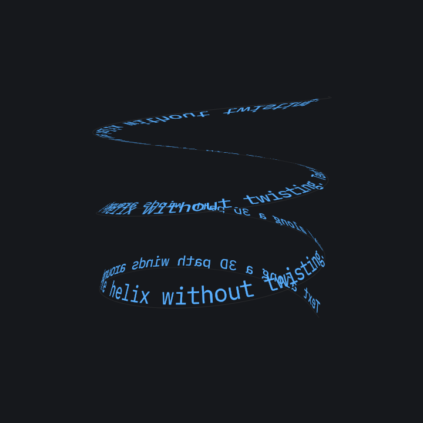

# orx-text-on-contour

Write texts on contours.

<!-- __demos__ -->
## Demos
### DemoExtrudedText01

Demonstrates [extrudeText]: solid letters from a text layout, here text along a helix laid out by
[layoutTextOnPath3D]. Every glyph is filled, with the holes of letters cut out, and extruded along the z-axis of its
placement, 0.3 units deep and centered on the path. Drag with the mouse to orbit around.

[source code](src/jvmDemo/kotlin/DemoExtrudedText01.kt)

### DemoSlugTextOnContour01

Demo Functionality includes:
- Loading and applying a specific font (`IBMPlexMono-Regular`) with a size of 32.0.
- Creating a circular contour at the center of the screen with a radius of 200.0.
- Rendering text along the rectified circle's contour.
- Offsetting text positions, enabling repeated text rendering along the same contour.

[source code](src/jvmDemo/kotlin/DemoSlugTextOnContour01.kt)

### DemoSlugTextOnContour02

Demo Functionality includes:
- Placing text on a circular contour with different baseline offsets.
- A positive offset moves the text away from the contour towards its ascenders, a negative offset moves it the
other way. Glyph spacing is measured on the offset baseline, so the text keeps its natural spacing.
- A superscript placed with [TextStyle.baselineShiftInEm].

[source code](src/jvmDemo/kotlin/DemoSlugTextOnContour02.kt)

### DemoSlugTextOnContours01

Demo Functionality includes:
- Loading and applying a specific font (`IBMPlexMono-Regular`).
- Creating a series of concentric circular contours.
- Typesetting a text such that it overflows from one contour to the next.

[source code](src/jvmDemo/kotlin/DemoSlugTextOnContours01.kt)

### DemoSlugTextOnContours02

Demo Functionality includes:
- Typesetting right-to-left Arabic text (Article 1 of the Universal Declaration of Human Rights)
such that it overflows from one wavy contour to the next.
- Using [Direction.RIGHT_TO_LEFT] to lay out the words of every line from right to left.

[source code](src/jvmDemo/kotlin/DemoSlugTextOnContours02.kt)

### DemoTextOnContour01

Demo Functionality includes:
- Loading and applying a specific font (`IBMPlexMono-Regular`) with a size of 32.0.
- Creating a circular contour at the center of the screen with a radius of 200.0.
- Rendering text along the rectified circle's contour.
- Offsetting text positions, enabling repeated text rendering along the same contour.

[source code](src/jvmDemo/kotlin/DemoTextOnContour01.kt)

### DemoTextOnPath3D01

Demonstrates [layoutTextOnPath3D]: text along a 3D path, here a helix, the 3D counterpart of text on a contour.

Every glyph gets a transform that places its outline in the frame of the path where it stands, the frames of
PosePath3D, which start with their y-axis up and turn as little as possible, so the text runs along the helix
without twisting. The text is drawn with a [SlugTextDrawer] from the glyphs of the layout, and slides along the
path over time. Drag with the mouse to orbit around.

[source code](src/jvmDemo/kotlin/DemoTextOnPath3D01.kt)
